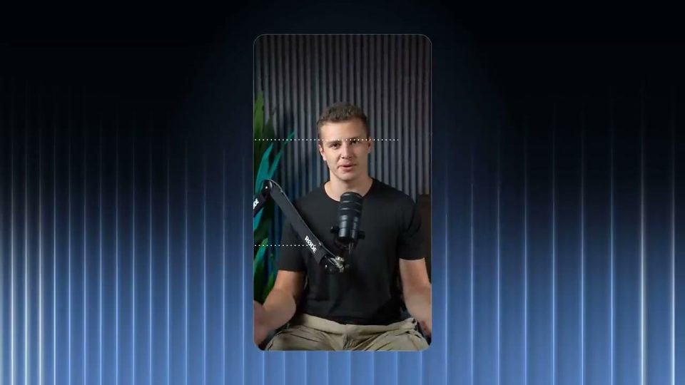
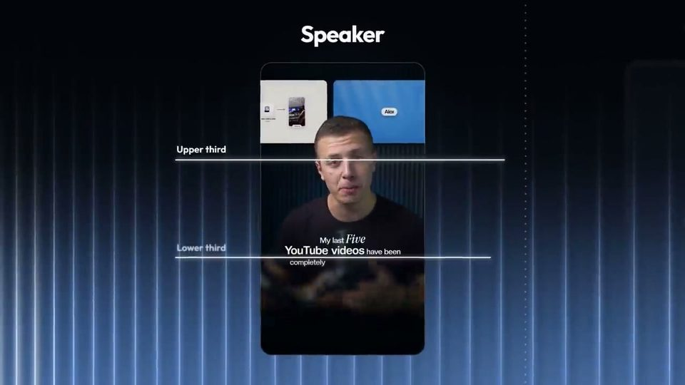
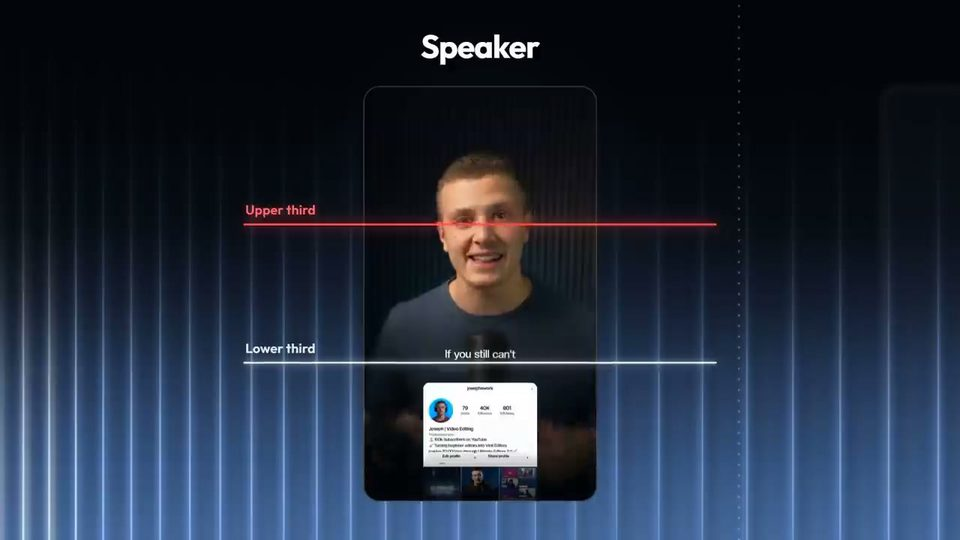
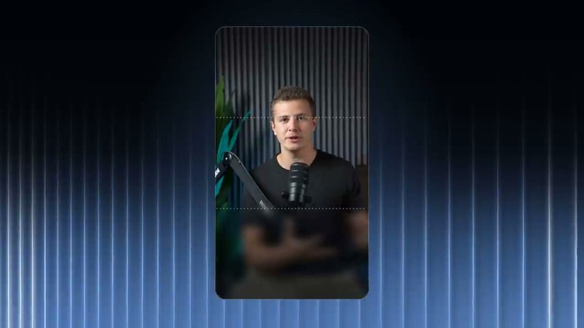
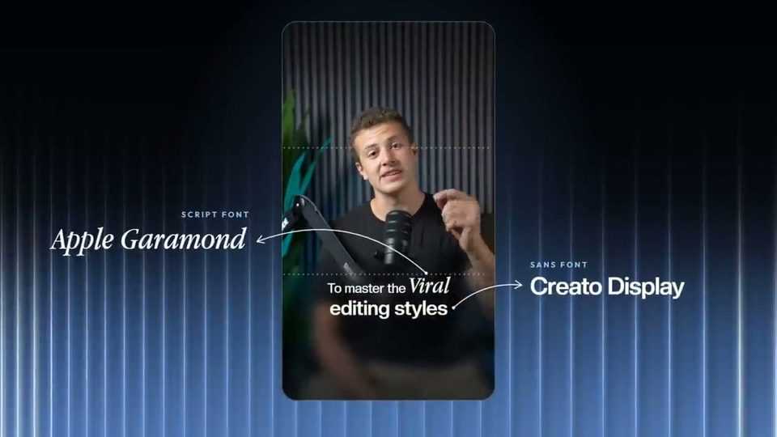
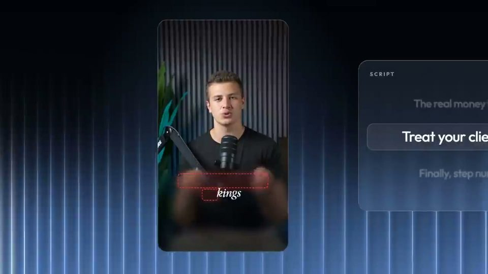
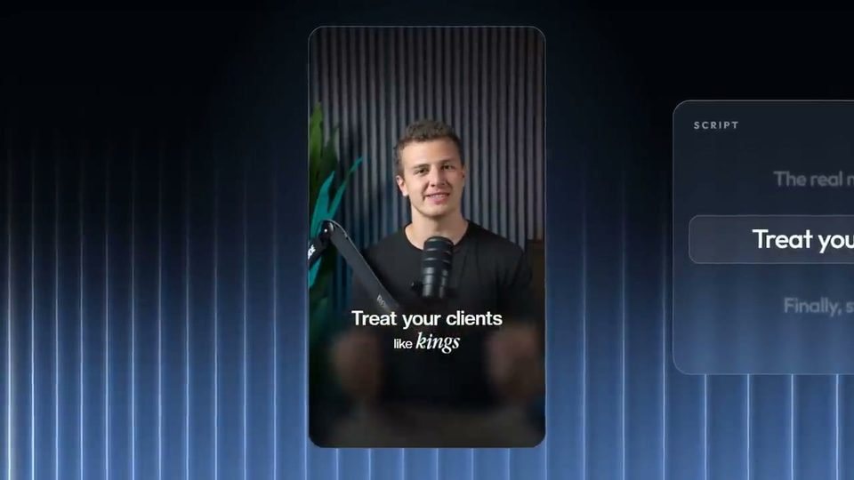
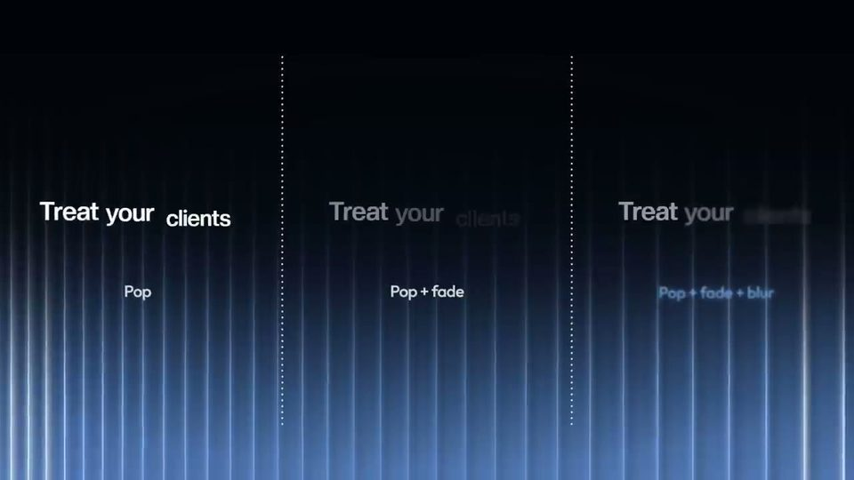
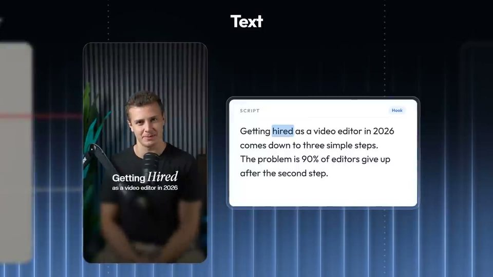
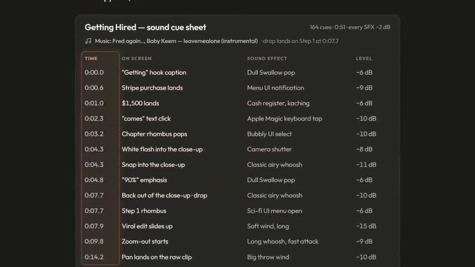

# Destilado: Joseph — Premium Instagram Reels (Estilo propio de Joseph)

- **Video:** *How to Edit Premium Instagram Reels Using ONLY Claude! (Full Breakdown)*
- **URL:** https://youtu.be/7g9Qm1e00zU
- **Fecha:** 5 de noviembre de 2026
- **Duración:** 18:22 (`1102 s`)
- **Modelo y entorno mostrados:** Claude Desktop con pestañas `Chat | Cowork | Code` (`[14:30]`), modelo **Opus 5.5 Extra** (`[10:28]`, `[14:30]`).
- **Motor de video:** **Remotion** (`[13:55]`).
- **Estilo de referencia:** El **estilo propio de Instagram de Joseph** (14 reels propios descargados; afirma que sus últimos 12 reels publicados se editaron con esta skill y uno alcanzó 90.000 vistas, `[00:00]`).
- **Clip editado en demo:** Video a cámara vertical propio de 1:20 crudo → 0:51 editado (*"Getting hired as a video editor in 2026 comes down to three simple steps"*, `raw edit.mp4` → `Getting Hired — v1.mp4`, `[10:50]`, `[14:30]`).

---

## 1. Resumen

Cinco días después del video de Arthur Brooks, Joseph aplica el mismo método a **su propio estilo de reels** (educativo/marketing personal con UI moderna, listicles en rombo, pop-ups tipo Stripe/notificación y animaciones full-screen dinámicas). El gran aporte diferencial de este video es doble:
1. Desarma con diagramas muy explícitos su **regla de composición 9:16 por tercios** (ojos en el tercio superior, oscurecido + blur en el tercio inferior, y armado jerárquico de captions palabra-clave primero).
2. Muestra por primera vez la anatomía formal del **Skill Pack en 3 bloques** (`Rule Book`, `Lookbook`, `Reference Folder` con ~200 animaciones) y un **Sound Cue Sheet real** con **164 cues en 51 segundos**, niveles exactos en dB y *beat drop* musical sincronizado al segundo exacto.

---

## 2. Composición y texto en 9:16

Esta sección consolida las mediciones exactas sobre lienzo **`1080×1920`** extraídas de los diagramas y ejemplos reales que Joseph muestra en **Key 1 (Captions, `[01:28–02:04]`)**, **Key 4 (Hooks, `[03:12–03:46]`)** y su tablero de **Figma (`[06:50]`)**.

### 2.1 Regla de tercios y encuadre de la persona (`[01:32–01:35]`, `[03:18–03:25]`)

Joseph divide el alto del cuadro vertical (`1920 px`) en tres tercios exactos:
- **Línea del tercio superior (*Upper third*):** teóricamente `y = 640 px` (`33,3%`). Medida en sus diagramas punteados (`[01:33–01:37]`) y sólidos (`[03:20–03:24]`): **`y = 642–646 px` (`33,4%–33,6%`)**.
- **Línea del tercio inferior (*Lower third*):** teóricamente `y = 1280 px` (`66,7%`). Medida en sus diagramas: **`y = 1284–1288 px` (`66,9%–67,1%`)**.
- **Posición de los ojos del hablante:** Joseph alinea los **ojos exactamente sobre la línea del tercio superior** para garantizar conexión visual inmediata (`[03:18]`). Mediciones con detector facial (YuNet) en 7 ejemplos del video:
  - Toma estándar de estudio (`[01:33–01:55]`): ojos en **`y = 644–668 px`** (`33,5%–34,8%`), nariz en `y = 710–744 px`, mentón en `y = 865–906 px`.
  - Tres reels reales mostrados bajo la línea roja *Upper third* (`[03:20–03:24]`): ojos en **`y = 540–629 px`** (`28,1%–32,8%`), mentón en `y = 835–961 px`.
  - Ejemplo de hook (`[03:33]`): ojos en **`y = 680 px`** (`35,4%`), mentón en `y = 914 px`.
- **Consecuencia geométrica:** La cabeza queda acotada al tercio superior (`y ≈ 360–910 px`), el pecho y el micrófono ocupan el tercio medio (`y ≈ 910–1280 px`), y queda un **espacio limpio de ~350–400 px** debajo del mentón para apoyar subtítulos y tarjetas de UI en el tercio inferior sin tocar jamás la cara.

### 2.2 Tratamiento del último tercio: oscurecido + desenfoque (`[01:35–01:38]`)

Antes de colocar una sola letra, Joseph arrastra dos efectos sobre el tercio inferior del A-roll: **Darkness** y **Blur** (`[01:36]`). Comparando píxel a píxel el mismo plano crudo (`[01:33]`) contra el plano tratado (`[01:37]`):
- **Dónde arranca:** La transición suave empieza justo en la línea del tercio inferior (**`y ≈ 1250–1280 px`**, `65%–67%` del alto), donde la luminancia cae un `12,4%` y la nitidez un `33,6%`.
- **Oscurecido (degradado negro neutro):** Color negro neutro (`RGB medio medido abajo ≈ 39, 40, 36`, sin tinte de color). En la franja de lectura de subtítulos (`y = 1344–1536 px`, `70%–80%`) reduce la luminancia de la imagen entre **27% y 33%**; en la franja inferior (`y = 1632–1920 px`, `85%–100%`) la reduce entre **51% y 59%**. Equivalente aproximado en CSS: `linear-gradient(to bottom, rgba(0,0,0,0) 62%, rgba(0,0,0,0.35) 75%, rgba(0,0,0,0.65) 100%)`.
- **Desenfoque (blur progresivo):** La energía de bordes (nitidez horizontal) cae un **61%–80%** en la zona del texto (`y = 1344–1632 px`) y hasta **88%–95%** cerca del borde inferior (`y = 1728–1920 px`). Esto anula la distracción visual de las manos, el pantalón y el escritorio para que el texto blanco flote con contraste máximo.

### 2.3 Armado de captions, tipografías, tamaños y animación (`[01:40–02:04]`, `[03:27–03:34]`, `[06:50]`)

- **Tipografías exactas** (confirmadas en pantalla `[01:47]` y en el tablero Figma `[06:50]`):
  - **Sans principal (texto regular y negrita):** **`Creato Display`** *(los subtítulos automáticos de YouTube transcriben erróneamente "Creator Display"; en pantalla dice claramente `SANS FONT · Creato Display`)*.
  - **Realce (Joseph la llama *"Script font"*, aunque tipográficamente es una serif condensada cursiva):** **`Apple Garamond` (Italic)**.
- **Colores (de su nota `The principles` en Figma, `[06:50]`):** **off-white** para el texto principal, y **color de acento** para palabras especiales solo cuando hace falta.
- **Método de armado en 3 pasos (`[01:48–01:56]`):**
  1. Toma la frase del guion (ej. *"Treat your clients like kings"*, *"To master the Viral editing styles"*, *"Getting hired as a video editor in 2026"*).
  2. **Primero** elige 1 o 2 palabras clave de máximo impacto emocional o temático (*"Viral"*, *"kings"*, *"Hired"*, *"Five"*) y las coloca en **`Apple Garamond Italic`** en el centro del bloque del tercio inferior.
  3. **Después** detecta visualmente los **huecos** (*gaps*) alrededor de esa palabra destacada —arriba, abajo o a los costados, mostrados con cajas punteadas rojas en `[01:52.5]`— y encaja el resto de la oración en **`Creato Display`** (combinando peso Bold para sustantivos/verbos fuertes y Regular/chico para conectores).
- **Tamaños medidos (altura real de tinta proyectada a `1080×1920`):**

| Ejemplo en pantalla | Palabra / línea | Tipografía | Alto de tinta medido (`1080×1920`) | Rango vertical `y` | Ancho / centro `x` |
|---|---|---|---|---|---|
| `[01:47]` `"To master the Viral / editing styles"` | `"To master the"` | Creato Display Regular | **46 px** | `1333–1379 px` | `x = 231–605` |
| | `"Viral"` | Apple Garamond Italic | **121 px** | `1261–1382 px` | `x = 605–852` |
| | `"editing styles"` | Creato Display Bold | **93 px** | `1419–1512 px` | `x = 244–839` |
| `[01:55.5]` `"Treat your clients / like kings"` | `"Treat your clients"` | Creato Display Bold | **82 px** | `1299–1381 px` | `x = 198–882` (`cx=540`) |
| | `"like"` | Creato Display Regular | **40 px** | `1430–1470 px` | `x = 392–472` |
| | `"kings"` | Apple Garamond Italic | **91 px** | `1400–1491 px` | `x = 493–691` |
| `[03:33.5]` Hook `"Getting Hired / as a video editor in 2026"` | `"Getting"` | Creato Display Bold | **77 px** | `1151–1229 px` | `x = 261–538` |
| | `"Hired"` | Apple Garamond Italic | **87 px** | `1124–1212 px` | `x = 565–826` |
| | `"as a video editor in 2026"` | Creato Display Regular | **37 px** | `1249–1286 px` | `x = 257–823` (`cx=540`) |

- **Relaciones de proporción y encaje:**
  - **Jerarquía de 3 niveles:** conector chico (`~37–46 px` de tinta) → sans bold (`~77–93 px`, ~`2×` el conector) → serif italic de realce (`~87–121 px`, ~`1,1×–1,3×` el bold y `2,2×–2,6×` el conector).
  - **Alineación y márgenes:** El bloque completo queda **centrado en `x ≈ 540 px`**, ocupando ~`560–685 px` de ancho (`x ≈ 200–880 px`), dejando ~`200 px` libres por lado.
  - **Posición vertical según haya o no UI debajo:**
    - Captions de cuerpo sin UI debajo (`[01:47]`, `[01:55.5]`): arrancan justo en la línea del tercio inferior (`y ≈ 1260–1300 px`) y llegan hasta `y ≈ 1490–1512 px`.
    - Captions de hook **con tarjeta UI debajo** (notificación de Stripe en `[14:30]`, perfil de IG en `[03:22.5]`, foto circular en `[03:24]`): el texto sube ligeramente para apoyarse **encima** de la línea de tercio inferior (`y ≈ 1124–1286 px`), reservando `y ≈ 1320–1600 px` para el elemento visual de soporte.
- **Animación del texto (`[01:58–02:04]`, Figma `[06:50]`):** Compara tres niveles (`Pop` → `Pop + fade` → `Pop + fade + blur`) y elige el tercero: **entrada palabra por palabra** partiendo ligeramente más abajo, con baja opacidad y blur inicial, que arranca rápido y frena suave (*ease-out*). En su nota de Figma indica: *"The text starts slightly lower, faded out, with a blur. The total animation length is 1 second [para la frase / entrada progresiva]. It starts fast and then slows down smoothly."*

### 2.4 Cómo graba / acomoda la cámara para cumplir la regla

Aunque Joseph no hace un tutorial de set de iluminación, en todos los cuadros de su crudo (`[01:33]`, `[03:20–03:24]`, `[14:30]`) queda evidente cómo prepara el plano:
- Graba un **plano medio amplio de cintura/cadera hacia arriba** (nunca primer plano cerrado), con la cámara a la altura de los ojos y **aire generoso arriba de la cabeza** (~`360–530 px` desde el borde superior hasta el pelo).
- Ese aire superior empuja deliberadamente sus **ojos hacia `y ≈ 640 px` (tercio superior)**, deja el brazo del micrófono y el torso en el tercio medio, y garantiza que **todo el tercio inferior (`1280–1920 px`) sea torso bajo / manos / escritorio** —zona prescindible que se puede oscurecer y desenfocar sin amputar gestos importantes ni invadir la cara.
- Si el crudo viene con otro encuadre o se hace punch-in dramático (como en el segundo beat del demo: *"The problem is 90% of editors give up..."*, `[12:30]`), le pide a Claude **tracking de la punta de la nariz al centro** para mantener estable la geometría.

---

## 3. Las 5 claves del estilo propio de Joseph (`[01:25–04:30]`)

1. **Key 1 — Captions (`[01:28–02:04]`):** Regla de tercios, darkness + blur abajo, `Creato Display` + `Apple Garamond Italic`, armado palabra-clave primero + huecos, animación `Pop + fade + blur`.
2. **Key 2 — UI Listicles en pantalla (`[02:05–02:32]`):** Para videos por capítulos (1, 2, 3). Un **rombo** con degradado sutil, borde fino y número centrado; se presentan los 3 en fila horizontal al inicio con pop-up fade, y luego cada vez que entra un capítulo se reutiliza el rombo a la izquierda con el título del capítulo a la derecha (confirmado en Figma `[06:52]`).
3. **Key 3 — UI Pop-ups y contadores en pantalla (`[02:33–03:10]`):**
   - Comparación antes/después: objeto izquierda → flecha limpia → objeto derecha.
   - Mención de software o evento: notificación flotante con fondo difuminado (*glassmorphism*), logo y texto (ej. pago de Stripe `+$1,500.00`).
   - Timers/contadores: anillo circular con trazo gris de fondo, progreso en color y número en el centro.
   - Listas múltiples: tarjeta cuadrada difuminada con ítems entrando en secuencia.
4. **Key 4 — Hooks de 3 piezas (`[03:12–03:48]`):** **Speaker** (ojos en tercio superior) + **Text** (palabra gancho destacada en el tercio inferior) + **Visual** (elemento concreto que refuerza la promesa debajo del texto: notificación Stripe, timer `0:59`, cifra `$3,000`, capturas de ediciones).
5. **Key 5 — Animaciones a pantalla completa (`[03:48–04:26]`):** Ocupan ~50% del video y llevan el mayor impacto: timelines de capítulos deslizantes, showcases full-screen de grabaciones de pantalla, placas tipográficas de alto contraste y **zoom-outs fuera de cuadro** (*out-of-screen zooms*) que sacan al espectador del A-roll hacia un mosaico de ediciones o un paneo de crudo → editado.

---

## 4. Proceso paso a paso con marcas de tiempo

1. **Recolección (`[05:35–05:55]`):** Descarga **14 reels** propios a una carpeta `Reference Videos`.
2. **Tablero de Figma (`[05:58–07:20]`):** Pantalla dividida (videos a la izquierda, Figma a la derecha). Captura **120+ imágenes** (`image 1..120`, `[06:50]`) y arma 6 secciones en `The Joseph Editing Style`: `Inspiration board`, `Caption Extras`, `Step one: how to do the captions`, `Step 2: On-screen UI listicles`, `Step 3: UI pop-ups, numbers, and counters`, `Step 4: How we hook our viewers`, `Step 5: How to create full-screen animations`. En cada sección pone 3 columnas: `The breakdown` (imagen anotada) | `The principles / Animation` (reglas escritas) | `The full reference board`.
3. **Entrenamiento en Claude (`[07:25–09:05]`):** Sube los 14 videos + el tablero de Figma a Claude (`Opus 5.5`, `[07:35]`). Claude genera el Skill Pack `short-form-editing-style`: **Rule Book** + **Lookbook** (`Text Design` + `Animation Design`, con etiquetas `Shapes · Colors · Gradients · Icon styles`, `[08:40]`) + **Reference Folder** (~200 animaciones: captura + keyframe sheet + breakdown).
4. **Cortes en bruto (`[10:22–11:08]`):** Abre Claude Code (`Opus 5.5 Extra`), escribe `"Load up my short form editing skill."` (`[10:50]`), adjunta `raw edit.mp4` (`1:20`) y pide transcripción palabra por palabra + corte ajustado de silencios y malas tomas.
5. **Documento de planificación (`[11:10–13:35]`):** Pide el documento HTML (`Getting Hired - 3 Simple Steps · reel plans`, `[11:45]`), que incluye por fila (`L01`, `L02`...): a la derecha el texto, rango de frames (`S1 · f3–127`), botón play (`▶ 0:00.1–0:04.2`); a la izquierda caja de notas libres + hasta 4 diseños recomendados opcionales. Dedica **~15 min** a planificar escena por escena.
6. **Construcción en Remotion (`[13:36–14:15]`):** Entrega el plan; Claude cruza plan + skill, junta assets y arma el video en Remotion en **~41 min** (`Worked for 41m` visible en `[14:30]`, entrega `Getting Hired — v1.mp4`, `0:51`, `1080×1920`).
7. **Revisión y corrección (`[14:15–15:10]`):** Manda **9 correcciones concretas** en una sola pasada (Claude tarda **~10 min** porque ya tiene el proyecto Remotion armado).
8. **Sonido y música (`[15:12–15:48]`):** Pide sound design + música. Claude genera el **Sound Cue Sheet** (`164 cues · 0:51 · every SFX −2 dB`, música `Fred again.., Baby Keem — leavemealone (instrumental)` con el **drop aterrizando en Step 1 en `0:07.7`**, `[15:25]`), aplica todos los efectos, chequea volumen y entrega el master (`[15:50–16:40]`).

---

## 5. Prompts textuales

### Prompt 1 — Entrenamiento de la skill (`[07:30–08:00]`, audio + inicio en pantalla `[07:35]`)
> *"First, you're going to break down the 14 reference videos into a word-by-word transcript and a frame-by-frame breakdown. Then, you're going to study three main things: the design principles of every scene — the colors, layout, effects, and everything else; the animation logic — what does each element have as an animation, a pop-up, fade-in, a blur reveal, and so on; and the placement of the animations and timing relative to the script of the video. Then, you're going to use the Figma breakdowns as a deep analysis of the design principles of this editing style. So, study it and analyze how the style's made. Learn everything there is to this editing style so that you can recreate it and turn it into a skill."*

### Prompt 2 — Carga de skill y corte crudo (`[10:40–10:55]`, pantalla `[10:50]` + audio)
> *"Load up my short form editing skill."*
> *(adjuntando `raw edit.mp4`)*
> *"Do a word-by-word level transcript of the video, finding all the silences and all the bad takes, and cutting them all out with tight cuts."*

### Prompt 3 — Documento de planificación (`[11:25–11:45]`, audio)
> *"Use the transcript of the video to create a planning document for me to plan out what I want each scene to look like. On the right, it's going to have each script line and on the left, it's going to have an empty text box where I can plan out my edit. Based on the study that you did on my short-form content, recommend four potential designs for each scene that I could choose from."*

### Prompt 4 — Generación del edit (`[13:38]`, pantalla `[14:30]`)
> *"Create the edit using the plan as a guide to what it needs to create. Use the skill as a guide on how it needs to look."*

### Prompt 5 — Revisión (9 cambios, `[14:25–14:55]`, pantalla `[14:30]` + audio)
> 1. *"Speed up the slide down animation of Stripe."*
> 2. *"Increase the scale of the chapter three listicle."*
> 3. *"Remove these animations in the tracking scene."*
> 4. *"Show a viral edit in this scene."*
> 5. *"Smoothen out this zoom out."*
> 6. *"Completely change this design to where the camera snaps to the personal brand on the left and then added on the right."*
> 7. *"Decrease the user icons in this scene."*
> 8. *"Change the design of the graphs here to one with a blueprint grid in the background."*
> 9. *"Change this scene to a one-line text scene because it actually made a mistake when building it."*

---

## 6. Herramientas, skills y arquitectura del paquete

- **Entorno:** Claude Desktop (`Code` / `Cowork` con `Opus 5.5 Extra`), **Figma**, **Remotion**.
- **Estructura del Skill Pack (`short-form-editing-style`, `[08:25–09:05]`):**
  1. **`Rule Book`**: tamaños de fuente, espaciado, layout, curvas de animación y velocidad de movimiento.
  2. **`Lookbook`** (`[08:40]`): guía visual dividida en `Text Design` (`Captions · full-screen text`) y `Animation Design` (`Pop-ups · listicles · counters · full-screens`), cubriendo `Shapes`, `Colors`, `Gradients`, `Icon styles`.
  3. **`Reference Folder`**: ~200 animaciones extraídas de los 14 videos; cada carpeta guarda **captura de diseño** + **keyframe sheet** + **breakdown escrito**.

---

## 7. Tiempos, costos, errores y diseño sonoro

- **Tiempo total:** **~1 h 30 min** (`[15:45]`): cortes + planificador (~10 min) + planificación humana (~15 min) + armado Remotion (**41 min**, `[14:30]`) + 9 revisiones (**10 min**) + sonido y música (~10–15 min).
- **Costo:** Solo plan de Claude (Remotion + Figma gratuitos para individuo).
- **Errores detectados en v1:** Animación de Stripe lenta, rombo del capítulo 3 chico, exceso de animaciones en la toma de tracking, zoom-out brusco, exceso de íconos de usuario, estilo de gráfico incorrecto (pedía grilla blueprint) y una escena mal armada que tuvo que simplificar a una línea de texto.
- **Sound Cue Sheet real (`[15:25]`):** **164 cues en 51 segundos** (~3,2 efectos/s), con reducción global `every SFX −2 dB` y niveles relativos muy precisos:
  - Pops / impactos clave (`Dull Swallow pop`, `Cash register kaching`, `Sci-fi UI menu open`): **−6 dB**
  - Flash / obturador (`Camera shutter`): **−8 dB**
  - Notificaciones / whoosh largo (`Menu UI notification`, `Long whoosh, fast attack`): **−9 dB**
  - Clicks / UI / whooshes estándar (`Apple Magic keyboard tap`, `Bubbly UI select`, `Classic airy whoosh`, `Big throw wind`): **−10 a −11 dB**
  - Viento suave de deslizamiento (`Soft wind, long`): **−15 dB**
  - Música: instrumental con **drop sincronizado exactamente a la entrada de Step 1 (`0:07.7`)**.

---

## 8. Trucos de edición destacados

- **Ruptura de patrón en el segundo 4 (`[12:30]`):** Cuando dice *"The problem is 90% of editors give up..."*, corta a primer plano con **tracking de nariz al centro**, **desatura la imagen** y agrega **reverb a la voz**, para después soltar el drop musical al entrar en Step 1 (`0:07.7`).
- **Alinear el beat drop con el primer capítulo (`[15:25]`):** El gancho corre con tensión y el golpe de la canción cae exactamente sobre la entrada del rombo *"Step 1"*.
- **Planificar en 15 minutos mirando solo la línea actual (`[11:45]`):** Que cada fila del planificador tenga su propio botón `▶` de reproducción de ese fragmento (`0:00.1–0:04.2`) acelera muchísimo la toma de decisiones del editor.
