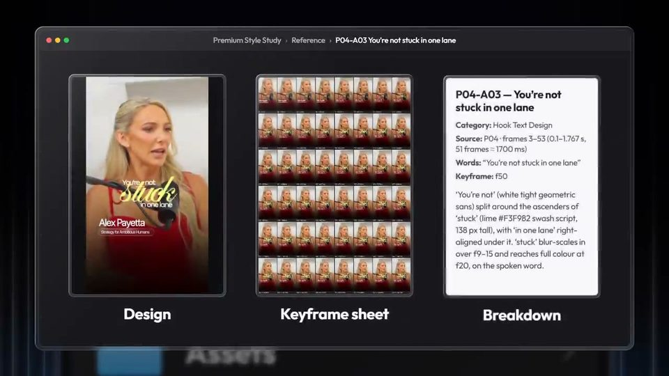

# Destilado: Joseph — Viral Podcast Clips (Jensen Huang / Nvidia)

- **Video:** *How to Edit VIRAL Podcast Clips Using ONLY Claude! (New Premium Style)*
- **URL:** https://youtu.be/F4oV-UTLSWs
- **Fecha:** 23 de noviembre de 2026
- **Duración:** 20:07 (`1207 s`)
- **Modelo y entorno mostrados:** Claude Desktop / Code con **Opus 5.5 · High** (`[09:50]`, `[11:45]`, `[12:40]`, `[16:05]`, `[17:20]`) + acceso a Chrome en PC.
- **Motor de video:** **Remotion** con un **`remotion-kit` prearmado dentro de la propia skill** (`remotion-kit/src/Main.tsx` visible en `[10:35]`).
- **Referencias estudiadas:**
  - Para `Podcast Clipper Skill`: **9 clips virales de podcasts** de Instagram (pregunta del entrevistador + respuesta del invitado con cambios de ángulo, `[05:42]`).
  - Para `Premium Short-Form Editor Skill`: **10 reels virales** de estilo podcast premium (`[07:58]`).
- **Clip editado en demo:** Podcast completo de **45:07** (*"The Rise and Reckoning of Jensen Huang — The Circuit with Emily Chang"*, `[11:45]`) → clip viral de ~52 s (*"There's this weird thing called ambition"*, `[16:05]`, `[18:25]`).

---

## 1. Resumen

Es el video más reciente y maduro de los cuatro. Muestra el pipeline completo **de punta a punta desde un podcast largo de 45 minutos hasta un reel 1080p terminado** encadenando **dos skills separadas**:
1. **`Podcast Clipper Skill`:** analiza un podcast entero multi-cámara y extrae en menos de 10 minutos un clip crudo que arranca con pregunta del entrevistador, mantiene cambios de ángulo frecuentes y cierra con conclusión del invitado.
2. **`Premium Short-Form Editor Skill`:** toma ese clip crudo, lo pasa a 9:16 con tracking suave de rostro/nariz, extrae automáticamente 2–3 paletas de color adaptadas al A-roll, genera un **planificador HTML donde Joseph puede pegar imágenes de referencia directo por línea** (sin recomendaciones automáticas de la IA), construye escenas usando un **kit reutilizable de Remotion** (`remotion-kit/src/Main.tsx`) enviando hojas de diseño por escena, aplica 4 revisiones en 10 min, arma el cue sheet de SFX en <10 min y manda 5 previews musicales integrados al video.

*(Los primeros 5 minutos del video cubren negocio/prospección: 2 estrategias para conseguir clientes —podcasts chicos de ~6.000 suscriptores a los que se les manda un clip editado gratis, o surfear tendencias como Nvidia/GTA 6 en Instagram— y matemática de ingresos: 2 h por clip con 15 min activos = 3 clips/día = 3 clientes × 30 clips/mes a USD 30–80 = USD 1.000–5.600/mes, `[01:00–05:15]`.)*

---

## 2. Los 3 fundamentos de diseño del estilo (`[08:18–09:15]`)

Al desarmar ~70 capturas de las 10 referencias en Figma, Joseph reduce todo el estilo a **3 constantes**:
1. **Fuentes (`[08:25]`, `[08:40]`):** Dos fuentes elegidas según el nicho del hablante: una **sans fina regular** (*thin sans*) para el relleno y una **fuente especial** (serif o sans bold) para la palabra destacada.
2. **Colores (`[08:42]`):** Mirá el A-roll, identificá los colores dominantes del set/vestuario, elegí **1 acento** y extraé **2 versiones vibrantes** (una clara y una oscura) + **2 neutras** (blanco y negro). En el paquete de assets (`[10:35]`) se ve la tabla real de estudio de paletas con columnas **`DARK GROUND | SET | TEXT`** y códigos hex reales (ej. `#08161A` teal-black set + `#F2E6DF` warm-white filler; `#0D0A09` + `#896359` sand curtain + `#FFF6E8` cream filler; `#586A4C` sage set wall + `#FFFDF3`).
3. **Texturas (`[09:00]`, `[10:35]`):** Tres texturas constantes reutilizadas en todas las escenas: **tela rugosa** (*rough cloth*), **puntos de semitono** (*halftone dots*) y **papel claro suave** (*light paper texture*).

---

## 3. Proceso paso a paso con marcas de tiempo

### Fase A — Entrenamiento de las 2 skills (`[05:25–11:00]`)
1. **`Podcast Clipper Skill` (`[05:35–07:05]`):** Carga **9 clips virales de podcast** (`[05:50]`). Le pide transcribir y analizar cuadro por cuadro **qué patrones comparten**: cómo es el gancho y cómo se recortó del podcast largo, cómo se desarrolla la historia, qué se deja y qué se corta, dónde hay frases puente, cuándo habla el entrevistador vs. el invitado, y **cada cuánto cambian los ángulos de cámara**. Claude concluye las reglas (arrancar siempre con pregunta del entrevistador → respuesta concisa con valor/historia → cambio de ángulo cada pocos segundos). Joseph la prueba con un podcast de muestra y, al confirmar que funciona, le pide empaquetarla como skill.
2. **`Premium Short-Form Editor Skill` (`[07:50–10:55]`):** Baja **10 reels virales**, junta ~70 capturas en Figma, desarma en detalle `Text Scenes (A-roll)` (`[09:00]`), `B-roll scenes` y `Full-screen animations`, y exporta el tablero como **`Figma breakdown.pdf`** (`[09:40]`, `[09:50]`). Sube la carpeta `Reference folder` (10 videos) + `Figma breakdown.pdf` a Claude (`Opus 5.5 · High`) y corre el prompt de entrenamiento (`[09:50]`).
3. **Calibración iterativa (`[10:42]`):** Admite explícitamente que **"llevó un día entero de revisiones que Claude realmente aprendiera a editar bien"** con la skill antes de dejarla lista para producción.

### Fase B — Producción completa desde podcast de 45 min (`[11:15–19:18]`)
1. **Clipeo multi-ángulo (`[11:25–12:28]`):** Nuevo proyecto en `Opus 5.5 · High`. Sube el podcast completo de Jensen Huang (`45:07`, `[11:45]`) y dispara el prompt de `Podcast Clipper Skill`. En **menos de 10 minutos** Claude transcribe, mapea cambios de cámara, elige la mejor pregunta-gancho y devuelve el clip crudo multi-ángulo con conclusión clara.
2. **Corte 9:16 + tracking suave + planificador con pegado de imágenes + 3 paletas (`[12:30–14:05]`):** Envía el segundo prompt (`[12:40]`, `[13:45]`). Pide:
   - Reencuadre vertical 9:16 manteniendo la **cara en la mitad superior** y la **nariz alineada al centro**, con **tracking suave** (sin movimientos bruscos y sin salirse de cuadro).
   - Transcripción completa + documento de planificación con cajas vacías a la izquierda (**explícitamente SIN recomendaciones de escenas**) y **soporte para pegar/arrastrar imágenes de referencia** por línea (`+ Reference image (click here, or click the box and paste / drop)`, `[15:00]`).
   - Extracción del color de acento del video + **2 o 3 opciones de paleta** basadas en el estudio de paletas de la skill (`[13:55]`). Joseph elige la opción **azul**.
3. **Planificación humana con referencias pegadas (`[14:05–15:48]`):** Planifica cada línea (`L01`, `L04`, `L07`, `L09`...) siguiendo una regla editorial simple (`[15:35]`):
   - **A-roll:** frases de transición y descanso visual (con lower-third de presentación al arrancar cada hablante).
   - **B-roll:** momentos emocionales o escenas con personas/objetos concretos (ej. Jensen sosteniendo un chip con *selector box*, cliente comprando).
   - **Animaciones full-screen:** momentos de alto valor conceptual (ej. gráfico de 2 barras productividad ↑ vs. contratación ↓).
   En cada línea pega la imagen de referencia exacta que quiere replicar.
4. **Construcción en 40 minutos con previews por etapa (`[15:48–17:08]`):** Pega el plan (`PLAN - Joseph (2026-11-20)`, `[16:05]`). En el reloj de pantalla se ve el ritmo real:
   - `03:15` (`[16:05]`): Arma la **Asset list** (11 ítems: *Jensen illustration, Nvidia logo, Jensen holding a chip, Customer at a checkout, Day sky, Night sky, Hourglass, Clouds, Jensen working, The crowd, The meeting table*) y los descarga abriendo Chrome en la PC.
   - `13:23` (`[16:25]`): Arma los **captions** (selecciona la palabra especial de cada frase —ej. `fraction` en `L01`— en fuente especial + color acento, rodeada de thin sans) y manda la **hoja de diseño de captions** para confirmar antes de seguir.
   - `19:01` (`[16:40]`): Joseph aprueba (`"They look perfect. Build out the edit."`). Claude construye escena por escena usando las reglas de la skill y manda **hojas de diseño individuales** (*Design sheet · 1 scene*, ej. `Bar graph scene`, `[16:40]`, luego line graph, B-roll con texto, layout de 2 objetos, escena del cielo, B-roll de chips y reunión). Joseph nota que el gráfico de línea no le gusta, **pero no interrumpe**: anota todo para el bloque final de revisiones (`[16:45]`).
   - Renderiza el primer borrador completo (~40 min en total).
5. **Revisión puntual en 10 minutos (`[17:08–17:42]`):** Envía **4 ajustes concretos** (`[17:20]`):
   1. Cambiar la segunda escena de gráfico de línea por una **escena de dos círculos/objetos** (pegando una captura de referencia al lado, `[17:20]`).
   2. Bajar la intensidad de la textura en los B-roll.
   3. Agregar una forma detrás del layout vertical.
   4. Inclinar el reloj de arena (*hourglass*) para que encaje mejor en el diseño.
   En **10 minutos** Claude devuelve el v2 aprobado.
6. **Cue sheet de sonido + 5 previews musicales (`[17:45–18:22]`):** Claude arma la tabla de cues de SFX para cada animación y completa todos los efectos en **menos de 10 minutos**. Además **recuerda de sesiones previas** que a Joseph le gusta audicionar la música, así que le manda **5 versiones de preview** de cómo suena cada pista puesta sobre el video (`[18:10]`). Joseph elige la #3 y Claude exporta el master 1080p (`[18:22–19:18]`).

---

## 4. Prompts textuales

### Prompt 1 — Entrenamiento de `Premium Short-Form Editor Skill` (`[09:50]`, textual en pantalla)
*(Adjuntos: `Reference folder · 10 videos` + `Figma breakdown.pdf`, modelo `Opus 5.5 · High`)*
> *"I want you to analyze this editing style and learn how to re-create it.*
> *Start with a word by word transcript and a frame by frame breakdown of all 10 reference videos.*
> *First, study the design of every scene: the colors, the fonts, the textures and the layouts.*
> *Then study the animation logic: the text animations, the object animations, the camera movement and the transitions.*
> *Then analyze the animations in relation to the script: the timing and the psychology of the visuals.*
> *Finally, use the PDF breakdown to understand every single scene type, and turn all of this into the Premium Short-Form Editor skill."*

### Prompt 2 — Clipeo multi-ángulo del podcast de 45 min (`[11:45]`, textual en pantalla + audio)
*(Adjunto: `The Rise and Reckoning of Jensen Huang · 45:07`, modelo `Opus 5.5 · High`)*
> *"Here's the full podcast. It has different camera angles. It's an interviewer asking questions with the guest answering them. I want you to use the podcast clipper skill, do a full word-by-word transcript and a frame-by-frame breakdown, analyze the transcript and compare it to what you know as a good clip, and extract a very high-quality clip out of it. Then use the frame-by-frame breakdown to analyze where the camera angles are and make sure the clip has multiple camera angles in it so that it's more entertaining to watch instead of just a plain simple angle. The clip should start with one of the interviewer's questions and end with a conclusion from the guest."*

### Prompt 3 — Corte 9:16, tracking, planificador con pegado de imágenes y paletas (`[12:40]` y `[13:45]`, textual en pantalla)
> *"Edit this video in the premium podcast editing style we recently built. First, I want the raw cut. Do a frame-by-frame breakdown, turn the clip into a vertical video and track every character while they speak, so their face stays in the upper half with their nose aligned in the center of the screen. Just make sure the tracking is smooth. Don't make it rough, fast, with very heavy movement, and so on. Just try to keep their face in the center of the screen without them going out of bounds.*
> *Give me the full transcript. Once you've done that, send in the raw clip for me. Then I want you to build out a document where I can plan out the full video, essentially with the script on the right side and the text on the left side. You don't have to recommend any scenes. I can just build them out myself. I also just want you to give me a feature inside the document where I can also paste in images, because I'm going to be pasting in some references for you inside of that document.*
> *As for the look, I want you to look at the video and extract the accent color. Based on the color palette from the color palette study that we've done in that skills editing style, I want you to also extract the best color palette that we could use, or give me at least two or three options of color palettes that we could use. Most likely, it's probably going to be an accent blue. Let me know how it looks."*

### Prompt 4 — Confirmación tras revisar captions (`[16:40]`, pantalla)
> *"They look perfect. Build out the edit."*

### Prompt 5 — Revisión con reemplazo por imagen de referencia (`[17:20]`, pantalla + audio)
> *"The bar graph looks perfect. For the second scene, instead of doing a graph, we have two circles, just like this reference [adjunta captura]. Tone down the texture on the B-roll scenes, add a shape behind the vertical layout scene, and tilt the hourglass so it fits the design better."*

---

## 5. Anatomía exacta del Skill Pack (`Premium Style Study`, `[10:20–10:40]`)

Es el detalle más valioso que se ve en pantalla en toda la serie:

1. **`Premium Style Study > Reference`** (`140 animations`, `[10:20]`, `[10:25]`):
   Carpetas nombradas `P<num_video>-A<num_anim> <nombre>` (ej. `P01-A02 Thin filler words spring-drop`, `P02-A02 Oxblood title card (hook headline)`, `P03-A05 Two-font hook + chrome sparkle`, `P04-A03 You're not stuck in one lane`).
   Cada carpeta contiene exactamente **3 archivos** (`[10:25]`):
   - **Design:** cuadro limpio del momento pico (`Keyframe: f50`).
   - **Keyframe sheet:** hoja de contactos 6×9 con la evolución cuadro por cuadro.
   - **Breakdown:** ficha técnica cuantificada en texto:
     > `P04-A03 — You're not stuck in one lane`
     > `Category: Hook Text Design`
     > `Source: P04 · frames 3–53 (0.1–1.767 s, 51 frames ≈ 1700 ms)`
     > `Words: "You're not stuck in one lane"`
     > `Keyframe: f50`
     > `'You're not' (white tight geometric sans) split around the ascenders of 'stuck' (lime #F3F982 swash script, 138 px tall), with 'in one lane' right-aligned under it. 'stuck' blur-scales in over f9–15 and reaches full colour at f20, on the spoken word.`
2. **`Rule book`:** reglas de tipografía, selección de color y armado de escenas.
3. **`Premium Style Study > Assets`** (`[10:35]`):
   - **`remotion-kit/` (`remotion-kit/src/Main.tsx`):** librería de componentes React/Remotion ya escritos y reutilizables para ese estilo (`Line`, `Pg`, `RoughDefs`, `NameCard`, `Pill`, `pillW`, `ARoll`, `Cam` con `{at: 0, kind: 'out', from: 1.22}`, `{at: 90, kind: 'track', zoom: 1.2}`, `Flash`, `Pan`, `SCENES`). Esto explica por qué las ediciones bajaron de 60 min a 40 min y salen consistentes.
   - **`Color palettes`:** tabla de referencia `DARK GROUND | SET | TEXT` con hex reales extraídos de las referencias.
   - **`Textures`:** los 3 archivos de textura (tela rugosa, halftone dots, papel liviano).
   - **`Fonts`:** archivos de fuentes empaquetados listos para usar.

---

## 6. Tiempos, errores y trucos

- **Tiempos reales medidos en este video:**
  - Clipeo desde podcast de 45 min: **<10 min** (`[12:22]`).
  - Corte 9:16 + tracking + planificador + paletas: ~10–15 min.
  - Planificación humana: ~15 min (`[03:15]`).
  - Construcción del v1 en Remotion (con 11 assets y previews): **~40 min** (`[15:52]`).
  - 4 revisiones: **10 min** (`[17:30]`).
  - Sound design + 5 previews musicales + render 1080p: **<10 min** (`[17:58]`).
  - **Total:** ~1 h 30 min – 2 h (con ~15 min de trabajo activo).
- **Trucos y lecciones clave:**
  - **No interrumpas a mitad de build (`[16:45]`):** Aunque veas una escena que no te gusta en las previews parciales (como el gráfico de línea), dejá que termine el v1 completo y agrupá todos los cambios en una sola tanda de revisión con capturas de referencia.
  - **Pegar imágenes directo en el planificador y en las revisiones:** Reemplazar una descripción verbal ambigua por una captura pegada en la línea (`L04`, `L07`, revisión #1) elimina casi por completo el error de interpretación estética.
  - **Kit de primitivas reutilizables por estilo (`remotion-kit`):** Guardar componentes parametrizados (cámara, `NameCard`, `Pill`, texturas SVG `RoughDefs`, `ARoll`) dentro de la carpeta del estilo evita que Claude reinvente el código desde cero en cada video.
  - **Memoria entre proyectos:** En `[18:05]` Claude recuerda la preferencia de Joseph de recibir previews musicales antes del render final sin que se lo vuelva a pedir.
