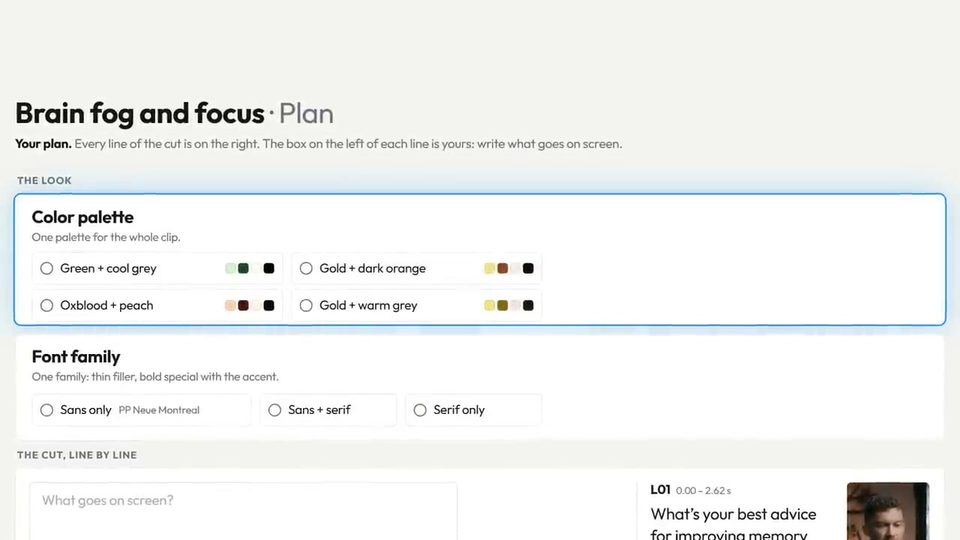

# Destilado: Joseph — Fable 5.2 Talking Head Premium Style (Dope Motion Zone)

- **Video:** *How to Edit VIRAL Talking Head Videos Using Fable 5.2! (New Premium Style)*
- **URL:** https://youtu.be/lnF3TUIWkO4
- **Fecha:** 11 de noviembre de 2026
- **Duración:** 22:18 (`1338 s`)
- **Modelo y entorno mostrados:** Claude Code / Claude Desktop con modelo **Fable 5.2 (High)** (`[10:35]`, `[14:05]`, `[14:25]`, `[15:15]`) + extensión de Chrome (`[17:58]`).
- **Motor de video:** **Remotion** (implícito en su stack / mencionado en el curso, `[07:38]`; renders de hojas de diseño y export final 1080p).
- **Estilo de referencia:** **Dope Motion Zone** (10 reels descargados de su cuenta, `[08:45]`).
- **Clip editado en demo:** Fragmento horizontal de 4:21 (`Raw clip.mp4`, `[14:25]`) recortado a ~60 s del podcast de **Chris Williamson con Andrew Huberman** (*"Brain fog and focus"*).

---

## 1. Resumen

Tercer video de la serie. Introduce cuatro saltos clave respecto a los dos anteriores:
1. **Teoría de color dinámica extraída del propio A-roll:** en lugar de usar un azul fijo como Arthur Brooks, enseña a derivar **4 colores desde un objeto real del plano** (ej. la lámpara amarilla del fondo → dorado brillante + naranja oscuro + blanco cálido + negro cálido).
2. **Reencuadre automático de 16:9 a 9:16 con tracking de nariz** y recorte de silencios hasta ajustar el clip a 60 s.
3. **Planificador HTML sin recomendaciones automáticas de IA**, reemplazado por un **selector de Look arriba** (`Color palette` + `Font family`) y cajas vacías por línea para que el humano dirija 100% la creatividad.
4. **Flujo de aprobación intermedia antes del render final:** Claude manda primero una **hoja de diseño de captions completa (`text design sheet v1`)** y al final ofrece **10 previews de 10 segundos de pistas musicales** para elegir de oído.

---

## 2. Los 4 principios del estilo (`[01:00–06:35]`)

1. **Principio 1 — Teoría de color dinámica + tipografías (`[01:12–02:30]`):**
   - **Color (`[01:25–02:02]`, pantalla `[01:45]`):** Mirá el A-roll y listá fuentes de color reales (remera, lámpara `#FACE7C`, ventana azul, fondo). Elegí una sola y derivá **4 colores**:
     1. Versión **vibrante clara** (ej. dorado).
     2. Versión **oscura y rica** (ej. naranja quemado).
     3. **Blanco teñido** hacia la temperatura del acento (blanco cálido o frío).
     4. **Negro teñido** hacia el acento (negro cálido o frío).
     Esos 4 colores gobiernan todos los fondos, elementos y textos del video entero.
   - **Tipografías (`[02:05–02:28]`, pantalla `[02:15]`):**
     - Texto regular (relleno): sans limpia (**`PP Neue Montreal`** o **`Urbanist`**), peso **`300–400`**.
     - Palabras especiales: script, serif o (la favorita de Joseph en este estilo) **versión bold de la misma sans**, peso **`600–700`**, teñida con el color de acento (`[02:15]`, `"it's an inability to focus"`).
2. **Principio 2 — A-roll, hooks y subtítulos (`[02:33–03:45]`):**
   - **Hook:** hablante siempre en la **mitad superior**; mitad inferior reservada para el texto gancho (frase más atractiva centrada en fuente especial + resto alrededor en sans fina).
   - **Lower-third de presentación del hablante (`[03:10]`):** cada vez que aparece un hablante nuevo (ej. Chris Williamson, luego Andrew Huberman), se agrega en la esquina inferior izquierda una tarjeta limpia con **nombre** (título) y **rol/cargo** (subtítulo). Verificado en `[18:15]`.
   - **Subtítulos del cuerpo (`[03:28]`):** **6 a 8 palabras por escena** (o una frase completa). En cada bloque se elige la palabra/frase especial en peso 600–700 y se alinea la sans fina 300–400 alrededor.
3. **Principio 3 — Escenas de B-roll e imágenes (`[03:47–04:50]`):**
   - **4 variantes con video (footage):** (a) clip completo con textura rugosa + bordes oscurecidos/blur + texto cinematográfico al centro; (b) flecha + texto señalando al sujeto; (c) **caja selectora con tracking** (*tracked selector box*) siguiendo un objeto; (d) líneas guía (*leading lines*) + paneo de cámara.
   - **2 variantes con imágenes:** (a) composición **lado a lado** (sujeto a un costado, texto cinematográfico al otro o parcialmente detrás del sujeto); (b) **diseño integrado en la imagen** (sujeto al centro, texto detrás del sujeto + líneas gráficas y texturas rodeándolo).
4. **Principio 4 — Animaciones full-screen (`[04:52–06:28]`):** 4 categorías:
   - **Alineación de dos objetos** (lado a lado o arriba/abajo, con sombra proyectada *cast shadow* y elementos difuminados en los bordes para dar profundidad).
   - **Gráficos y números** (gráfico centrado con texto alrededor, barras en mitad inferior con texto arriba, o progresiones con ilustraciones).
   - **Elementos reales dentro de animaciones** (fotos/videos reales encajados sobre fondo con borde/stroke limpio, partidos con texto al centro o en fila horizontal).
   - **Un solo objeto centrado** (objeto central con sombra proyectada + profundidad en bordes, ilustración limpia o showcase 3D realista con texto).

---

## 3. Proceso paso a paso con marcas de tiempo

### Fase A — Construcción de la skill (`[08:30–12:55]`)
1. **Referencias (`[08:38]`):** Descarga **10 reels** de Dope Motion Zone en una carpeta `Reference folder`.
2. **Tablero de Figma (`[08:55–10:15]`):** Captura todas las escenas buenas y las agrupa y desarma por escrito en `Hook Text Design`, `Body Text Design`, `B-roll` (4 footage + 2 imágenes) y `Full-screen animations` (4 tipos).
3. **Entrenamiento en Claude (`[10:20–12:45]`):** Sube `Reference folder` (10 edits) + `Figma breakdown` a Claude (`Fable 5.2`, `[10:35]`). Claude extrae **235 animaciones** en 14 categorías y empaqueta la **`Minimal Podcast Editing Skill`** (`[12:30]`).

### Fase B — Edición paso a paso del clip de Huberman (`[13:55–20:55]`)
1. **Corte crudo + reencuadre 9:16 con tracking de nariz (`[14:00–15:02]`):** Carga `Raw clip.mp4` (`4:21`, horizontal) en `Fable 5.2 High` (`[14:25]`). Pide transcripción palabra por palabra al milisegundo, desarme cuadro por cuadro, recorte de silencios hasta **60 s**, conversión a **9:16 vertical** siguiendo la **nariz del hablante alineada al centro vertical** en cada corte.
2. **Planificador HTML sin recomendaciones de IA (`[15:05–17:40]`):** Pide el documento `Brain fog and focus · Plan` (`[15:35]`). Arriba aparece la sección **`THE LOOK`** con:
   - `Color palette` (4 opciones con 4 muestras cada una): `Green + cool grey`, `Gold + dark orange` *(elegida)*, `Oxblood + peach`, `Gold + warm grey`.
   - `Font family`: `Sans only (PP Neue Montreal)` *(elegida)*, `Sans + serif`, `Serif only`.
   Abajo, **`THE CUT, LINE BY LINE`**: caja vacía `What goes on screen?` a la izquierda; línea `L01 0.00–2.62 s` + guion + miniatura a la derecha. Joseph planifica todo a mano (A-roll con lower-third al presentar cada hablante, 3 fotos con selector box + flecha al inicio para enganchar, moléculas en 3 círculos con sombra, A-roll en frases puente, escena de sueño en nubes, B-roll de ejercicio, cierre con las mismas moléculas rompiendo el umbral).
3. **Ejecución con checkpoints visuales (`[17:42–19:12]`):** Pega el plan. Claude arma la lista de assets y los descarga con la **extensión de Chrome**. Luego construye primero todos los subtítulos y envía **`Brain fog and focus - text design sheet v1 · Palette A (gold + dark orange) · PP Neue Montreal`** (`[18:15]`): una grilla 2×7 con cada pantalla de caption, número de frame (`f46 (1.53 s)`), y descripción de animación (`special glitches in letter by letter`, `thin sans, fades out (0.7 s)`). Después arma cada escena (selectores de B-roll, moléculas, foco, sueño, ejercicio, breakthrough) en **~45 minutos** y renderiza el 1080p.
4. **Sonido y audición de 10 músicas (`[19:14–19:45]`):** Como el render visual le gustó a la primera, pide pasar al workflow de sound design (ya entrenado). Claude audita el video en una tabla tiempo→evento→SFX, coloca efectos con niveles, y **envía 10 previews de 10 segundos de distintas pistas musicales** para que Joseph elija una. Aplica la elegida y exporta el master 1080p (`[19:46–20:55]`).

---

## 4. Prompts textuales

### Prompt 1 — Entrenamiento de la skill (`[10:30–11:18]`, audio + pantalla `[10:35]`)
> *"I want you to learn this premium minimal editing style. We've uploaded 10 references of what this editing style looks like and a full Figma board breaking down its design fundamentals. First, take the references and do a frame-by-frame breakdown with a word-by-word transcript on each of the 10 videos. Then study three things. First, analyze the designs, colors, layouts, effects, proportions, and fonts. Then analyze the animation logic, types of animations, timing, speed, and motion curve. And finally, analyze the animation behavior in relation to the script. After you do all of that, I want you to scan the Figma board we uploaded and use the full breakdown we've given you of every scene to write a complete rule book of this editing style. And after doing all of this, create the minimal short-form editing skill, the skill that can take raw videos and with our help in planning the edit, create the stunning edits in this exact editing style."*

### Prompt 2 — Transcripción, corte a 60 s y reencuadre 9:16 con tracking de nariz (`[14:20–14:42]`, pantalla `[14:25]` + audio)
> *"Do a word-by-word, millisecond-level transcript of this clip. Then create a frame-by-frame breakdown of the video. Cut out all the silences from the clip and bring it down to 60 seconds long. Then turn it into a vertical 9x16 video for Instagram, always keeping the speaker in the center of the screen. To ensure that no one gets out of the screen, simply track the nose of the speaker and always keep it aligned with the vertical center of the screen by tracking the speaker. Then deliver the full raw clip ready to be edited."*

### Prompt 3 — Documento de planificación (`[15:10–15:20]`, pantalla `[15:15]` + audio)
> *"Use the transcript you just created to create a planning document for me. On the right side, I want to see each line of the script and on the left side, I want empty boxes where I can plan out what my scene needs to look like."*

---

## 5. Herramientas y estructura exacta de la skill

- **Herramientas:** Claude (`Fable 5.2 High`), **extensión de Chrome** para bajar imágenes/B-roll/íconos, **Figma**, motor de composición/render (**Remotion**).
- **Anatomía de `Minimal Podcast Editing Skill` (vista exacta en pantalla `[12:30]` y `[12:15]`):**
  1. **`Breakdowns`** (`9 references · frame-by-frame studies`): estudio crudo cuadro por cuadro de cada referencia.
  2. **`Inspiration Guide`** (`14 categories · 235 animations`): subcarpetas por categoría (ej. `02 Body Text Design > P03-A06 Mask-rise serif + khaki FUTURE box`), donde cada animación contiene:
     - `still.png` (*Design still*, `[12:15]`)
     - hoja de keyframes (*keyframe sheet*)
     - archivo de breakdown de cómo está construida.
  3. **`Lookbook`** (`Color palettes · font styles`): paletas de 4 colores y combinaciones tipográficas permitidas.
  4. **`Skill file`** (`SKILL.md`): las instrucciones operativas que conectan todo lo anterior.

---

## 6. Revisión, tiempos, costos y trucos

- **Tiempo de construcción de animaciones:** **~45 minutos** (`[18:52]`). En este video no muestra correcciones visuales de v1 (aprueba directo), pero introduce el checkpoint intermedio del **`text design sheet v1`** (`[18:15]`) antes de pasar a las escenas, evitando renderizar 45 minutos con captions mal planteados.
- **Costos:** Solo suscripción de Claude (menciona no necesitar Higgsfield ni conocimientos complejos).
- **Trucos clave de edición:**
  - **Coherencia de motivo visual (callback):** cuando Huberman nombra las moléculas (dopamina, norepinefrina, epinefrina) al principio, muestra 3 círculos debajo de una línea de umbral; en la conclusión **reutiliza exactamente la misma metáfora visual** haciendo que los 3 círculos suban y atraviesen el umbral (`[17:25]`).
  - **Regla de presentación de hablantes:** en podcasts de 2 personas, cada primer plano de un hablante nuevo lleva lower-third limpio con nombre + rol abajo a la izquierda (`[03:10]`, `[18:15]`).
  - **Animación temprana de alto valor:** apenas se presenta la premisa (después del gancho en A-roll), dispara 3 imágenes rápidas con *selector box* + flecha para señalizar alta producción desde los primeros segundos (`[16:15]`).
  - **Audición musical en 10 previews de 10 s:** nunca deja que la IA elija la música a ciegas; siempre recibe previews cortos para aprobar de oído (`[19:35]`).
  - **Nose tracking explícito:** especificar *"track the nose of the speaker and keep it aligned with the vertical center"* evita encuadres descentrados o saltos bruscos al recortar podcasts horizontales (`[14:32]`).
