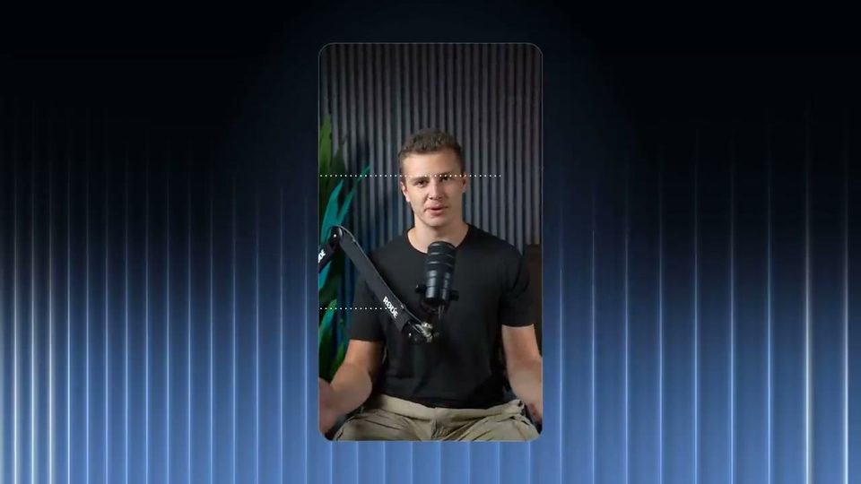
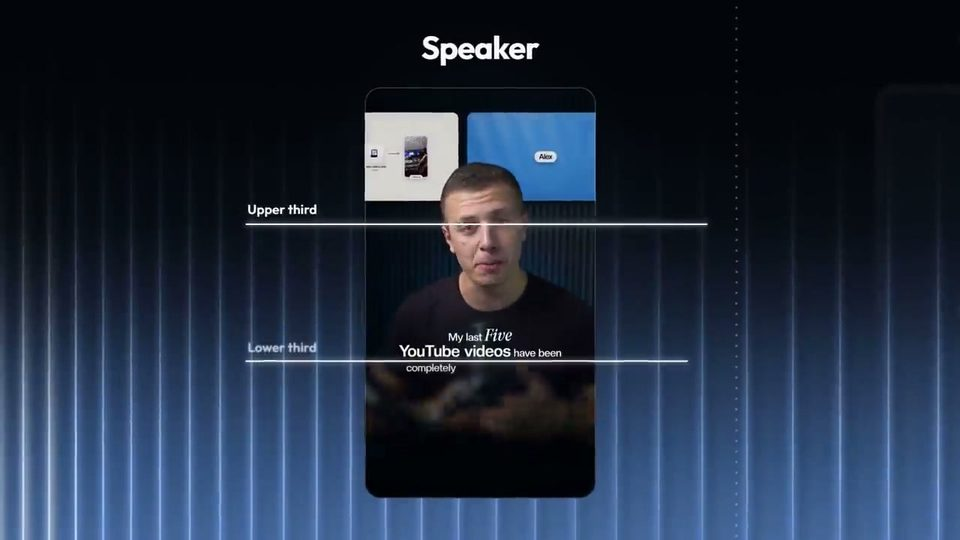
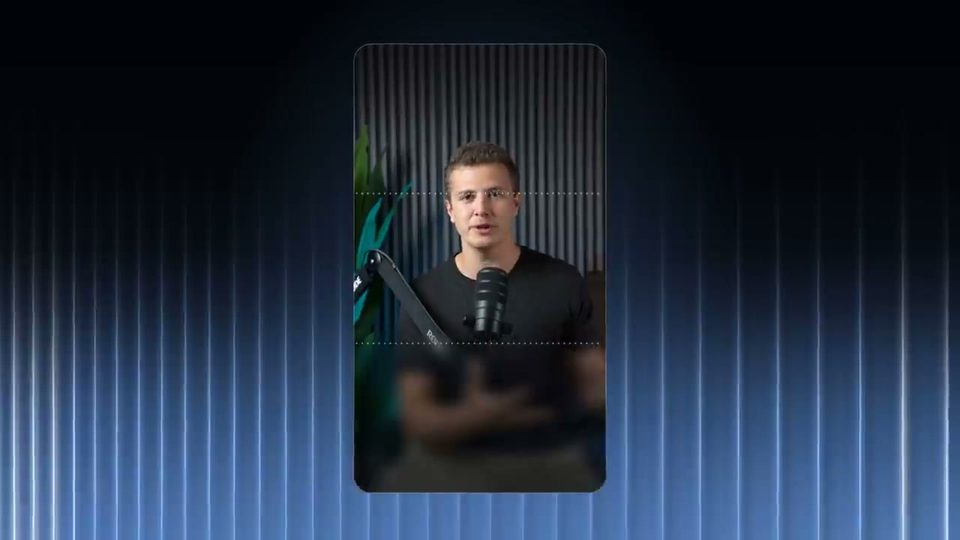
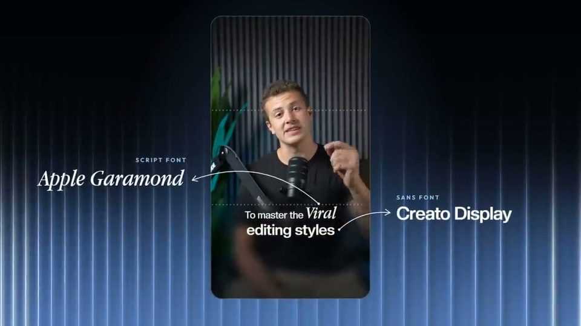
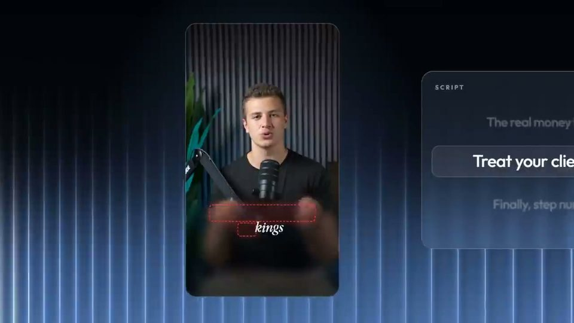

# Síntesis: el método de Joseph y propuesta para `kit-edicion-ia`

Este documento cruza los 4 videos analizados del canal *Joseph | Video Editing* (del 31 de octubre al 23 de noviembre de 2026) —[g9xoKm5DEeU](joseph-g9xoKm5DEeU.md), [7g9Qm1e00zU](joseph-7g9Qm1e00zU.md), [lnF3TUIWkO4](joseph-lnF3TUIWkO4.md) y [F4oV-UTLSWs](joseph-F4oV-UTLSWs.md)— y traduce sus hallazgos en una propuesta concreta para el kit de edición actual.

---

## 1. El proceso estandarizado común a los 4 videos

A lo largo de los cuatro videos, Joseph consolida exactamente el mismo sistema en **dos fases separadas**: primero destila referencias en una **skill de estilo reutilizable** (trabajo de una vez), y después usa esa skill para **producir cada clip** en ~1,5 a 2 horas de reloj (~15 minutos de trabajo humano activo).

### Fase 1 — De referencias a una skill de estilo (una vez por estilo)
1. **Curaduría acotada:** Junta entre **10 y 20 videos** de un mismo estilo (y ~9 clips si arma una skill aparte de clipeo de podcasts).
2. **Desarme humano del "por qué" visual:** Mira las referencias dos veces, captura entre **70 y 130 escenas** en Figma, las agrupa en familias de escenas (A-roll hook, A-roll cuerpo, B-roll, animaciones full-screen) y escribe a mano el desglose de **fuentes, colores, texturas, layout y animación** de un ejemplo por familia. *Tesis repetida en los 4 videos:* **los videos enseñan lógica/timing y el tablero enseña diseño** (`[g9xoKm5DEeU 11:00]`).
3. **Destilación por Claude:** Le entrega la carpeta de videos + el tablero/PDF de Figma y le pide siempre los mismos **3 ejes**:
   - **Diseño:** colores, fuentes, texturas, proporciones, layouts.
   - **Lógica de animación:** tipos de movimiento, duración en cuadros/ms, curvas, cámara y transiciones.
   - **Psicología/relación con el guion:** qué frase o intención dispara cada tipo de escena.
4. **Empaquetado en Skill Pack:** Claude genera un paquete persistente que combina reglas (`Rule Book` / `SKILL.md`), estudio visual (`Lookbook` de paletas y tipografías), **biblioteca indexada de animaciones** (`140–235` subcarpetas con `still` + `keyframe sheet` + `breakdown` cuantificado) y, en la versión más madura, un **kit de componentes reutilizables** (`remotion-kit/src/Main.tsx` + texturas + fuentes).
5. **Calibración:** Reconoce que dejar una skill afinada lleva **~1 día de pruebas y correcciones** (`[F4oV-UTLSWs 10:42]`), pero después sirve para decenas de videos.

### Fase 2 — De un crudo al video terminado (cada clip)
1. **Clipeo (si viene de un podcast largo):** Skill dedicada (`Podcast Clipper Skill`) elige un momento pregunta→respuesta con múltiples ángulos de cámara en <10 min.
2. **Corte crudo + encuadre vertical:** Transcripción palabra por palabra al milisegundo, recorte de silencios (30 ms de padding) y malas tomas, y conversión 16:9→9:16 con **tracking suave de rostro/nariz** en la mitad superior.
3. **Planificador HTML interactivo (el corazón del método):** Claude genera un archivo HTML con el guion línea por línea (`L01`, `L02`…) y reproductor embebido a la derecha, selector de paleta/tipografía arriba, y cajas editables a la izquierda. **El humano dedica ~15 min a decidir qué se ve en cada línea** (A-roll para transiciones/descanso, B-roll para historias/personas, animación full-screen para conceptos clave).
4. **Recolección de assets + checkpoints visuales:** Claude arma la `Asset list` y busca material real (Wikipedia, Pexels, logos). Primero construye **todos los captions** y manda una **hoja de diseño (`text design sheet`)** para aprobar antes de invertir 40 min en escenas; luego arma escena por escena enviando previews (`Design sheet · 1 scene`) hasta renderizar el v1 (~40–60 min).
5. **Una sola ronda agrupada de revisiones:** Asume que el v1 sale al **60–70%**. No interrumpe durante el armado; junta todos los cambios en una **lista numerada con timestamps y capturas de referencia** (4 a 9 ítems) que Claude resuelve en **~10 min**.
6. **Diseño sonoro por Cue Sheet + audición musical:** Solo tras aprobar lo visual, Claude genera una **tabla de cues** (`tiempo | evento en pantalla | SFX | dB`), coloca efectos con niveles jerárquicos y envía **5 a 10 previews de música** para que el humano elija de oído antes del render 1080p final.

---

## 2. Qué cambió entre el primero (31-oct) y el último (23-nov)

En apenas 23 días el flujo de Joseph maduró muchísimo en **control humano**, **velocidad** y **consistencia técnica**:

| Dimensión | Video 1 (`g9xoKm5DEeU`, 31-oct) | Video 2 (`7g9Qm1e00zU`, 5-nov) | Video 3 (`lnF3TUIWkO4`, 11-nov) | Video 4 (`F4oV-UTLSWs`, 23-nov) |
|---|---|---|---|---|
| **Referencias** | 20 videos (Arthur Brooks) + 130 capturas Figma | 14 videos propios + 120 capturas Figma | 10 videos (Dope Motion Zone) + Figma | 9 clips (`Clipper`) + 10 videos (`Editor`) + PDF Figma |
| **Color** | Paleta fija (azul + blanco/negro papel) | Paleta fija de marca (off-white + acento) | **Dinámica:** 4 colores extraídos de un objeto del A-roll | **Semi-automática:** Claude propone 2–3 paletas del A-roll y el humano elige |
| **Reencuadre 9:16** | Clip ya vertical | Grabado vertical a cámara | **Nuevo:** 16:9 → 9:16 con **tracking de nariz** | 16:9 multi-cámara → 9:16 con tracking suave y cara en mitad superior |
| **Planificador HTML** | Claude recomienda **3 diseños/beat** + citas *Seen in the reels* | Notas libres + **4 recomendaciones** opcionales | **Sin recomendaciones de IA**; agrega selector de `Color palette` y `Font family` | **Explícitamente sin recomendaciones de IA**; agrega **pegar/arrastrar imágenes de referencia** por línea |
| **Arquitectura de la skill** | Reglas + carpeta `225 Animations` | `Rule Book` + `Lookbook` + `Reference` (~200) | `Breakdowns` + `Inspiration Guide` (14 cat. / 235) + `Lookbook` + `SKILL.md` | `Reference` (140, fichas con px/hex/frames) + `Rule book` + **`Assets` con `remotion-kit/src/Main.tsx`**, paletas, texturas y fuentes |
| **Checkpoints antes del render** | Solo v1 completo (60 min) | Solo v1 completo (41 min) | **Nuevo:** manda `text design sheet v1` de captions antes de las escenas (45 min) | Manda hoja de captions para confirmar + `Design sheet · 1 scene` por escena (40 min) |
| **Sonido y música** | Claude elige SFX y música solo | **Sound Cue Sheet real** (`164 cues`, dB exactos, beat drop) | Audit de SFX + **10 previews de 10 s** de música | Cue sheet SFX (<10 min) + **5 previews de música sobre el video** |

**Los 3 giros más reveladores de esta evolución:**
1. **Pasó de pedirle creatividad a Claude a quitarle las recomendaciones del planificador** (`[F4oV-UTLSWs 13:45]`): *"You don't have to recommend any scenes. I can just build them out myself. Give me a feature where I can paste in images."* Lo que sí funciona espectacular es que el humano pegue 1 captura de referencia por línea y en las revisiones.
2. **Pasó de regenerar código de cero a incluir un `remotion-kit` dentro del estilo** (`[F4oV-UTLSWs 10:35]`): encapsular primitivas (`NameCard`, `Pill`, `ARoll`, `Cam`, texturas `RoughDefs`) bajó el armado de 60 min a 40 min y subió la fidelidad visual.
3. **Metió checkpoints baratos antes del render caro:** aprobar la hoja de captions (`text design sheet`) y audicionar previews musicales evita re-renderizar todo el video por un error de gusto.

---

## 3. Composición y texto en 9:16

Consolidación exacta del sistema visual que Joseph explica con diagramas en `7g9Qm1e00zU` (`[01:28–02:04]`, `[03:12–03:46]`, `[06:50]`) y extiende a podcasts en `lnF3TUIWkO4` y `F4oV-UTLSWs`. Todas las coordenadas están medidas directamente sobre sus cuadros y proyectadas a **`1080×1920`**.

### 3.1 Regla de tercios y encuadre del hablante
- **División vertical exacta en tres tercios (`1920 / 3`):**
  - **Línea del tercio superior (*Upper third*):** `y = 640 px` (`33,3%`). Medido en sus diagramas: **`642–646 px`** (`33,4%–33,6%`).
  - **Línea del tercio inferior (*Lower third*):** `y = 1280 px` (`66,7%`). Medido en sus diagramas: **`1284–1288 px`** (`66,9%–67,1%`).
- **Posición de los ojos:** Siempre alineados sobre la línea del tercio superior (`y ≈ 640 px`). Medido con YuNet en 7 ejemplos reales de `7g9Qm1e00zU`: **`y = 540–680 px`** (`28,1%–35,4%`), con la nariz en `y = 637–759 px` y el mentón en **`y = 835–961 px`**.
- **Cómo graba o reencuadra para lograrlo:**
  - En estudio propio (`7g9Qm1e00zU`): plano medio amplio desde la cintura/cadera, con **aire generoso arriba de la cabeza** (`360–530 px` libres arriba del pelo) para que los ojos caigan en `y ≈ 640 px` y todo el último tercio (`1280–1920 px`) sea torso bajo/manos/escritorio sacrificable.
  - En podcasts 16:9 recortados a 9:16 (`lnF3TUIWkO4 [14:32]`, `F4oV-UTLSWs [12:40]`): ordena explícitamente mantener la **cara en la mitad superior** con la **nariz centrada verticalmente** y tracking suave sin saltos.




### 3.2 Oscurecido y desenfoque del último tercio (`[7g9Qm1e00zU 01:35–01:38]`)
Comparando el plano crudo (`[01:33]`) contra el plano tratado (`[01:37]`):
- **Arranque:** Justo en la línea del tercio inferior (**`y ≈ 1250–1280 px`**, `65%–67%`).
- **Oscurecido:** Degradado negro neutro (sin tinte) que baja la luminancia **`27%–33%`** en la franja del texto (`y = 1344–1536 px`) y **`51%–59%`** hacia el borde inferior (`y = 1632–1920 px`). Receta CSS equivalente para HyperFrames:
  `linear-gradient(to bottom, rgba(0,0,0,0) 62%, rgba(0,0,0,0.35) 75%, rgba(0,0,0,0.65) 100%)`.
- **Desenfoque (*blur*):** Desenfoque gaussiano progresivo enmascarado en el último tercio que reduce la nitidez horizontal entre **`61% y 80%`** detrás del texto y hasta **`95%`** abajo, eliminando el ruido visual de manos y ropa para que el texto off-white destaque sin necesidad de cajas sólidas.



### 3.3 Armado de captions y catálogo de tipografías en los 4 videos
- **Método de composición tipográfica (común a los 4 videos):**
  1. Tomar una frase corta (≤ 5 palabras en Arthur Brooks / Joseph; 6–8 palabras en Dope Motion Zone).
  2. Elegir **primero** la(s) palabra(s) de mayor carga emocional o temática y ubicarla(s) en la **tipografía de realce** en el centro del bloque (`"Viral"`, `"kings"`, `"Hired"`, `"fraction"`, `"stuck"`).
  3. Llenar los **huecos** (*gaps*) arriba, abajo o a los lados con el resto de la frase en la **sans principal** en tamaño más chico o peso fino.
- **Tamaños reales medidos en `7g9Qm1e00zU` (proyectados a `1080×1920`):**
  - Conector / relleno sans (`Creato Display` Regular): **`37–46 px`** de altura de tinta (~`52–64 px` font-size).
  - Sans destacada (`Creato Display` Bold): **`77–93 px`** de tinta (~`100–125 px` font-size).
  - Palabra clave (`Apple Garamond` Italic): **`87–121 px`** de tinta (~`1,1×–1,3×` el bold y `2,2×–2,6×` el conector). En `F4oV-UTLSWs [10:25]`, la ficha real `P04-A03` reporta **`138 px tall`** para la palabra `stuck`.
- **Posición vertical y encaje:**
  - Captions de cuerpo sin tarjeta abajo: **`y = 1261–1512 px`** (`66%–79%`), centrados en `x = 540 px` con ancho de `560–685 px` (~`200 px` de margen lateral).
  - Hooks **con visual/UI abajo** (notificación Stripe, perfil IG, avatar): el bloque de texto sube a **`y = 1124–1286 px`** (`58,5%–67%`) para dejar `y = 1320–1600 px` libres a la tarjeta.
- **Animación (`[7g9Qm1e00zU 02:03]`, `[06:50]`):** **`Pop + fade + blur`** palabra por palabra (entra desde unos px más abajo, opacidad 0 y blur inicial, con curva *ease-out* rápida al arrancar y frenado suave).
- **Todas las tipografías nombradas o mostradas en los 4 videos:**

| Video / Estilo | Fuente base (sans) | Fuente de realce (especial) | Pesos / tratamiento |
|---|---|---|---|
| `g9xoKm5DEeU` (Arthur Brooks) | **Inter** | **Playfair Display Italic** (serif) | Bold en centro + sans chica en huecos |
| `7g9Qm1e00zU` (Joseph Reels) | **Creato Display** | **Apple Garamond** (serif condensada italic; Joseph la llama *"script"*) | Off-white + acento opcional; `Pop + fade + blur` |
| `lnF3TUIWkO4` (Dope Motion Zone) | **PP Neue Montreal** o **Urbanist** | Misma sans en **Bold** (o serif/script) | Regular `300–400` + especial `600–700` en color acento del A-roll |
| `F4oV-UTLSWs` (Podcast Premium) | Thin geometric sans (por nicho) | Serif, bold sans o **swash script** (`P04-A03`) | Color acento extraído del set (`#F3F982`, azul, etc.) |




> **Cruce importante con las reglas actuales del kit (`editar-video/criterio/subtitulos.md`):**
> Joseph centra en `x = 540 px` y en algunos ejemplos deja bajar el subtítulo hasta `y ≈ 1512 px`. Nuestro kit ya tiene una ventaja medida para Reels/TikTok: centra en **`x = 510 px`** (ancho máx `840 px`, esquivando los botones derechos en `x > 940`) y fija la línea base en **`y = 1240 px`** (tope preferente `y ≤ 1340 px`, máx `1530 px`). **Conclusión:** adoptar del método de Joseph la **regla de ojos en `y ≈ 640 px`** (en `preparar-video`) + el **oscurecido/blur suave del tercio inferior** + el **armado jerárquico palabra-clave primero**, manteniendo **nuestra zona segura `x = 510` / `y ≤ 1340`** para que Instagram/TikTok nunca tape nada.

---

## 4. Qué usa Joseph de pago/cerrado vs. qué podemos hacer gratis y local

| Necesidad | Lo que usa Joseph (pago / cerrado) | Alternativa 100% gratis y local en `kit-edicion-ia` |
|---|---|---|
| **Orquestación IA** | Claude Desktop Cowork/Code en plan **Max ($100/mes)** con Opus 5.5 Extra / Fable 5.2 High. | Claude Code (o cualquier plan existente del usuario) descargando **todo lo mecánico** (transcripción, cortes, detección facial, mediciones, hojas de cuadros) a scripts locales Python/CLI → consume una fracción de tokens. |
| **Transcripción al milisegundo** | Proceso opaco dentro de Claude (probablemente Whisper local o API). | **WhisperX** local (`.claude/skills/transcribir`, gratis, exactitud palabra por palabra con `wav2vec2`). |
| **Cortes, silencios, voz y tracking 9:16** | Scripts que Claude improvisa en cada sesión. | **`preparar-video`** local en Python + ffmpeg + **Silero VAD ONNX** + **YuNet ONNX** + `arnndn`/`loudnorm` en una sola pasada (determinista, reproducible y gratis). |
| **Tablero visual de referencias** | **Figma** manual (requiere saber usar Figma y subir PDFs pesados). | Carpeta local de referencias + **hoja HTML generada localmente** (o `mi-estilo` guiado en terminal/navegador) sin cuenta ni software extra. |
| **Motor de composición y render** | **Remotion** (gratis ≤ 3 personas; licencia paga para empresas). | **HyperFrames** local (Apache-2.0, gratis sin licencia comercial) + **Lemo-Opuscar** local para escenas 3D/WebGL/pintura (y Remotion opcional solo si el usuario lo pide). |
| **Medición de referencias** | Claude "a ojo" sobre frames extraídos (alto costo de tokens visuales y riesgo de imprecisión). | **`npx hyperframes measure`** local y gratis (`probe`, `cuts`, `events`, `frames`, `ink`, `curve`, `look`) + **YuNet** (altura de ojos/cara) + **ffmpeg** (LUFS/picos/silencios). |
| **Búsqueda de imágenes/B-roll** | Extensión de Chrome manejada por Claude (Wikipedia, Pexels). | API/descarga local de **Wikimedia Commons**, **Pexels** (API gratuita), **Unsplash/Pixabay** o material real del usuario en `proyectos/<nombre>/assets/`. |
| **Tipografías** | Algunas fuentes comerciales/propietarias (`PP Neue Montreal`, `Apple Garamond`, `Creato Display`). | Equivalentes **OFL / Google Fonts** locales en `montaje/fonts/`: `Inter`, `Plus Jakarta Sans` o `Urbanist` (en vez de PP Neue Montreal / Creato Display), `Cormorant Garamond Italic` o `Instrument Serif Italic` / `Playfair Display Italic` (en vez de Apple Garamond). |
| **Biblioteca de SFX y música** | Banco privado de *Ultimate Editors* (curso pago de $299) + temas comerciales con copyright (*Fred again..*). | Banco local curado de **SFX CC0** (Freesound CC0 / Sonniss GDC gratuitos) organizado en las **3 familias de Joseph** (`whooshes/`, `textures/`, `risers-hits/`) + música libre de derechos (CC0/royalty-free del usuario) con previews cortos generados por `ffmpeg`. |
| **Planificador interactivo** | Documento generado por Claude Desktop. | **Archivo `planificador.html` local autocontenido** (cero backend, abre directo en el navegador con `<video>` local, selector de paleta, cajas por línea, pegado de imágenes base64/archivo y botón "Copiar plan" / "Guardar `plan-escenas.json`"). |

---

## 5. Propuesta concreta para `kit-edicion-ia`

El kit ya tiene cimientos técnicamente **superiores** a los de Joseph en ingeniería de audio/video (`transcribir` con WhisperX, `preparar-video` por índices de palabras con Silero VAD + YuNet + `loudnorm`, `montar-video` en 5 capas con `lint/validate/inspect`, y `revisar-export` con re-transcripción automática). Lo que nos falta —y es exactamente donde Joseph brilla— es **el puente entre referencias → biblioteca visual de estilo → planificación humana → primitivas reutilizables → diseño sonoro por cue sheet**.

### (a) Flujo de REFERENCIAS (carpetas por tipo de estilo → estilos/skills propias)

Crear una convención simple para que el usuario junte referencias sin usar Figma ni programar:

```text
referencias/
  minimal-arthur/           # el usuario tira acá 3 a 15 videos/links/capturas de un estilo
    ref-01.mp4
    ref-02.mp4
    notas.txt               # opcional: "me gusta cómo entran los títulos, no la música"
  podcast-premium/
  reel-ui-propio/
```

**Flujo completo con la skill `mi-estilo`:**
1. El usuario guarda sus videos (o pega links de YouTube/IG/TikTok que `mi-estilo` baja con `yt-dlp`) en `referencias/<nombre>/`.
2. `mi-estilo` corre primero la **pipeline de ingeniería inversa local** (ver punto b) sobre cada video de la carpeta —sin gastar tokens en lo medible— y consolida medianas, rangos y patrones repetidos entre videos.
3. Si el usuario quiere guiar el gusto (el equivalente gratis y sin fricción al tablero de Figma de Joseph), `mi-estilo` le abre un **tablero HTML local (`referencias/<nombre>/tablero.html`)** con las escenas detectadas agrupadas por familia (`hook`, `a-roll-captions`, `b-roll`, `full-screen`) donde puede tildar sus favoritas y escribir 1 línea de por qué le gustan.
4. Claude destila todo en **`estilos/propios/<nombre>/`** ampliando (sin romper compatibilidad) el formato actual del kit:

```text
estilos/propios/<nombre>/
  ESTILO.md                 # obligatorio: reglas numéricas, psicología cuándo usar cada escena, paletas, fuentes OFL, reglas de sonido
  subtitulos.html           # obligatorio: sub-composición HyperFrames lista (soporta 2 fuentes + palabra destacada + pop+fade+blur + degradado/blur inferior opcional)
  paletas.json              # nuevo (opcional): paleta fija o regla de extracción dinámica desde el A-roll (4 colores: acento claro, acento oscuro, blanco teñido, negro teñido)
  primitivas/               # nuevo (opcional): el "hyperframes-kit" del estilo (ej. lower-third.html, broll-selector.html, tarjeta-dato.html, grafico-barras.html, texturas SVG)
  referencias/              # nuevo (opcional): mini-catálogo indexado de mejores escenas (ej. R01-E03_hook-dos-fuentes/{still.jpg, keyframes.jpg, ficha.md})
```

- **Conexión con los 99 estilos de Lemo-Opuscar:** Si el usuario quiere mezclar una referencia suya con un estilo de Lemo (o crear un estilo propio basado en uno de los 99 de `.externas/lemo-opuscar/styles/<slug>/STYLE.md`), `mi-estilo` lee ese `STYLE.md`, extrae paleta + tipografía + texturas + curvas de movimiento y genera `ESTILO.md` + `subtitulos.html` + `primitivas/` nativos de HyperFrames (y anota en `ESTILO.md` qué escenas complejas conviene mandar a renderizar como MP4 con el motor de Lemo, igual que ya documenta `montar-video`).

---

### (b) Flujo de INGENIERÍA INVERSA de cualquier video

Qué medir, en qué orden exacto y qué archivo deja, separando siempre **`[MEDIDO]`** (determinista, 0 tokens) de **`[INFERIDO]`** (lectura visual/editorial de Claude):

| Orden | Qué se mide | Herramienta local (gratis) | Dato concreto que extrae |
|---|---|---|---|
| **1. Ficha técnica** | Resolución, fps, duración, audio, hash | `npx hyperframes measure probe` / `ffprobe` | `1080×1920`, `30 fps`, `duración_s`, canales audio |
| **2. Guion palabra a palabra** | Palabras, timestamps, velocidad (ppm), pausas | `transcribir` (WhisperX) | `palabras.json`, palabras/min, duración media de pausas |
| **3. Estructura, cortes y eventos** | Cortes de plano, apariciones/desapariciones, duración media de toma | `npx hyperframes measure cuts` + `measure events --map` | Lista de cortes en s, segundos promedio entre cortes, mapa de cambios por región |
| **4. Encuadre facial y tercios** | Posición de ojos, nariz, mentón y tamaño de plano | Script Python con **YuNet ONNX** (ya está en `.externas/modelos/`) cada 0,5 s | `ojos_y` en px/1920 (chequea regla del tercio superior `640 px`), `menton_y`, variación de zoom/tracking |
| **5. Muestreo visual y escenas** | Cuadros representativos por corte + tiras densas en entradas | `ffmpeg` / `npx hyperframes measure frames` | `hoja-global.jpg` + `escenas/E01..En/{still.jpg, keyframes.jpg}` |
| **6. Texto y tipografía** | Caja exacta, altura de tinta en px, renglones, posición, contraste | `npx hyperframes measure ink --at T --roi ...` + lectura visual en 3–5 stills | `y_min/y_max`, `alto_tinta_px`, palabras/bloque, jerarquía (conector vs. bold vs. realce), familia Google Fonts más cercana `[INFERIDO]` |
| **7. Color, luz y tratamiento del fondo** | Paleta dominante, calidez, degradado/blur inferior, texturas | `npx hyperframes measure look` + muestreo de luminancia/nitidez por franjas (como hicimos en `7g9Qm1e00zU`) | 4 colores base (acento claro/oscuro + neutros), si hay oscurecido/blur en tercio inferior y desde qué `y` |
| **8. Movimiento y curvas** | Duración de entradas/salidas en ms, sobrepaso y curva GSAP | `npx hyperframes measure curve` (o tira a 30 fps de 1 s si el fondo es complejo) | `duracion_ms`, `desplazamiento_px`, `blur_inicial`, curva (`power3.out`, `expo.out`, etc.) |
| **9. Sonido y ritmo sonoro** | Volumen integrado, picos, si hay música, ataques/transientes de SFX | `ffmpeg ebur128` + detección de picos/transientes en audio separado o banda alta | LUFS, presencia de música bajo voz vs. bajo animaciones, densidad aproximada de SFX/min |
| **10. Síntesis editorial `[INFERIDO]`** | Cuándo entra cada familia de escena respecto al guion | Claude leyendo `palabras.json` + `escenas/` + mediciones 1–9 | Reglas tipo *"cuando presenta un hablante → lower-third; cuando enumera → gráfico; en transición → A-roll"* |

**Archivos que deja en `proyectos/referencias/<nombre>/analisis/`:**
- `mediciones.json`: todos los números crudos etiquetados con `origen: "medido" | "inferido"`.
- `escenas/<ID>/`: `still.jpg`, `keyframes.jpg` (tira de entrada/desarrollo) y `ficha.md` (en el mismo formato preciso de Joseph `P04-A03`: categoría, frames, ms, palabras, colores hex, alturas en px y animación).
- `INFORME.md`: resumen legible en español para que el usuario valide antes de convertirlo en estilo en `estilos/propios/<nombre>/`.

---

### (c) Qué cambiaría o agregaría en cada skill del kit

| Skill / Pieza del kit | Qué ya hace bien | Qué agregaría o cambiaría inspirado en Joseph |
|---|---|---|
| **`mi-estilo`** | Ya usa `hyperframes measure` (`ink`, `curve`, `look`, `cuts`, `events`), `transcribir` y prueba en 10 s antes de guardar. | 1. Soportar **carpeta de múltiples referencias** (`referencias/<nombre>/`, 3–15 videos) agregando medianas entre videos, no solo 1–3 sueltos.<br>2. Agregar el **script de análisis automático** (pasos 1–9 de ingeniería inversa, incluyendo medición facial YuNet de altura de ojos y medición de degradado/blur del tercio inferior).<br>3. Generar **`tablero.html`** local para que el usuario elija sus escenas favoritas sin usar Figma.<br>4. Guardar en `estilos/propios/<nombre>/` además de `ESTILO.md` + `subtitulos.html`: **`paletas.json`** (soporte de paleta adaptativa al A-roll), **`primitivas/`** (bloques reutilizables de HyperFrames) y **`referencias/`** (fichas `still + keyframes + ficha.md`). |
| **`transcribir`** | WhisperX local con `palabras.json`, `texto.txt`, `subtitulos.srt`, `info.json`. | Agregar detección opcional de **pausas largas y repeticiones** distinguiendo muletillas de **repeticiones performáticas** (regla de Arthur Brooks `§10`: no borrar un *"up and up and up"* enfático), y en podcasts con 2+ hablantes, opcionalmente marcar **cambio de hablante** (diarización local o pista de cortes) para que `clipear-podcast` y `montar-video` sepan dónde poner el *lower-third* de presentación. |
| **`preparar-video`** | Cortes por índice de palabra, Silero VAD, YuNet tracking, voz a −14 LUFS. | 1. Agregar objetivo de encuadre explícito **"ojos en tercio superior (`y ≈ 640 px`)"** y **"nariz alineada al centro horizontal"** (hoy sigue la cara, pero calibrar el `target_y` de ojos al 33% garantiza la composición de Joseph en 9:16).<br>2. Exponer una opción configurable de padding de silencios más ajustado (ej. `40–80 ms` para ritmo reel ágil vs. `120–220 ms` conversacional).<br>3. Extraer automáticamente en `informe.json` los **3–4 colores dominantes del A-roll** (muestreando el plano limpio) para alimentar la paleta adaptativa de `montar-video`. |
| **`clipear-podcast`** | Propone 5–10 candidatos puntuados y produce por índices de palabra. | 1. Sumar una regla explícita de **estructura pregunta→respuesta** (si hay entrevistador + invitado, priorizar clips que arranquen en la pregunta del entrevistador y cierren en la conclusión del invitado).<br>2. Detectar **cambios de ángulo de cámara** (con `measure cuts` o histogramas) para priorizar tramos con variedad de planos o avisar si el plano es 100% estático (en cuyo caso `montar-video` compensa con zoom-in/out suaves). |
| **`montar-video`** | 5 capas limpias en HyperFrames, anclaje a `base-palabras.json`, `lint/validate/inspect`, ducking, integración con Lemo. | 1. **Generar un `planificador.html` local** (entre `preparar-video` y el armado) cuando el usuario pide un edit con múltiples escenas/gráficos: guion por línea + `<video>` local + selector de 2–3 paletas sugeridas desde el A-roll + cajas editables donde el usuario puede **pegar capturas de referencia** (sin forzar recomendaciones si no las pide).<br>2. **Checkpoint `hoja-subtitulos.jpg`:** renderizar primero solo 6–12 cuadros clave de los subtítulos (`text design sheet`) y mostrarlos antes de construir todas las escenas.<br>3. **Soporte nativo del tratamiento de tercio inferior** (degradado negro + `backdrop-filter: blur()` enmascarado desde `y ≈ 1250 px`), **captions jerárquicos de 2 fuentes** (palabra clave destacada primero + resto alrededor + `Pop + fade + blur`) y **lower-third automático** en el primer plano de cada hablante.<br>4. **Capa de SFX por `cue-sheet.json`:** generar primero la tabla de cues (`tiempo | evento | familia | archivo | dB`) usando un banco local CC0 en 3 familias (`whooshes` −10/−12 dB, `textures` −6/−7 dB, `risers-hits` −5 dB, pico alineado al cuadro más rápido, **sin música bajo animaciones full-screen** si el estilo lo pide).<br>5. **Audición musical local:** si hay una carpeta de pistas libres, generar con `ffmpeg` 3–5 previews de 10 s mezclados sobre el arranque del clip para que el usuario elija antes del render final. |
| **`revisar-export`** | Re-transcripción, desfase, LUFS, clipping, cara despejada, zona segura, hoja de cuadros. | 1. Agregar chequeo en la hoja de cuadros de **regla de tercios / altura de ojos** (avisar si la cara cayó muy abajo o el encabezado quedó pegado al borde superior).<br>2. Verificar el **cue sheet de SFX** contra picos/clipping en las uniones riser+hit.<br>3. Formalizar la **ronda de revisión numerada por timestamp** (como Joseph: el usuario mira v1 y pasa lista 1..N con segundos o capturas de referencia; Claude aplica todo en una sola pasada sin rehacer lo aprobado). |
| **`editar-video` + `criterio/`** | Orquestador limpio y criterios medidos muy sólidos. | 1. Incorporar la **regla de cadencia editorial** de Joseph a `criterio/graficos-y-broll.md`: *A-roll = presentación/transición/descanso; B-roll = historia/emoción/personas; Full-screen = conceptos/datos/mecanismos; callback visual al cierre*.<br>2. Sumar a `criterio/sonido.md` la estructura de **3 pasadas de SFX** (Whooshes → Textures → Risers+Hits) con tabla de cues obligatoria antes de mezclar.<br>3. Mantener el flujo rápido automático para pedidos simples ("poneme subtítulos") y activar el **`planificador.html`** solo cuando el usuario quiere un reel producido con gráficos/escenas a medida. |
| **`estilos/<nombre>/` + Lemo (99 estilos)** | 7 estilos del kit + catálogo de 99 estilos de Lemo traducibles a HyperFrames o renderizables como MP4. | Evolucionar `estilos/<nombre>/` para admitir opcionalmente `primitivas/` (componentes HTML/GSAP/SVG reutilizables del estilo, como el `remotion-kit` de Joseph) y `paletas.json` adaptativo. Además, crear 1 estilo nuevo en el kit inspirado en la estética editorial mínima (**2 fuentes + palabra clave destacada + oscurecido/blur en tercio inferior + 4 colores derivados del A-roll**) usando fuentes 100% OFL (`Inter` / `Urbanist` + `Instrument Serif Italic` / `Cormorant Garamond Italic`). |

---

## 6. Cuadros clave guardados

Todos los cuadros extraídos de los videos (máx. 12, 540 px de alto) están en `docs/destilado/cuadros/`:
- [01-tercios-base.jpg](cuadros/01-tercios-base.jpg) — Regla de tercios sobre A-roll crudo (`7g9Qm1e00zU [01:33]`).
- [02-tercio-inferior-blur-oscuro.jpg](cuadros/02-tercio-inferior-blur-oscuro.jpg) — Oscurecido + blur progresivo en el último tercio (`7g9Qm1e00zU [01:37]`).
- [03-tipografias-caption.jpg](cuadros/03-tipografias-caption.jpg) — `Apple Garamond` + `Creato Display` en `"To master the Viral editing styles"` (`7g9Qm1e00zU [01:47]`).
- [04-caption-huecos.jpg](cuadros/04-caption-huecos.jpg) — Armado palabra clave primero (`kings`) + detección de huecos (`7g9Qm1e00zU [01:52.5]`).
- [05-caption-armado.jpg](cuadros/05-caption-armado.jpg) — Bloque final `"Treat your clients like kings"` (`7g9Qm1e00zU [01:55.5]`).
- [06-animacion-texto.jpg](cuadros/06-animacion-texto.jpg) — Comparativa `Pop` vs. `Pop + fade` vs. `Pop + fade + blur` (`7g9Qm1e00zU [02:03]`).
- [07-hook-tercios-ej1.jpg](cuadros/07-hook-tercios-ej1.jpg) — Líneas `Upper third` (ojos) y `Lower third` (texto) en hook real (`7g9Qm1e00zU [03:20]`).
- [08-hook-tercios-ej2.jpg](cuadros/08-hook-tercios-ej2.jpg) — Hook con visual UI (perfil IG) debajo de `Lower third` (`7g9Qm1e00zU [03:22.5]`).
- [09-hook-palabra-clave.jpg](cuadros/09-hook-palabra-clave.jpg) — Elección de `"hired"` del guion → `"Getting Hired as a video editor in 2026"` (`7g9Qm1e00zU [03:33.5]`).
- [10-skill-referencia-ficha.jpg](cuadros/10-skill-referencia-ficha.jpg) — Ficha de referencia `P04-A03` (`Design` + `Keyframe sheet` + `Breakdown` con frames, px y hex) (`F4oV-UTLSWs [10:25]`).
- [11-planificador-html.jpg](cuadros/11-planificador-html.jpg) — Planificador HTML con selector de paleta/fuente y cajas por línea (`lnF3TUIWkO4 [15:35]`).
- [12-cue-sheet-sonido.jpg](cuadros/12-cue-sheet-sonido.jpg) — Sound cue sheet real de 164 cues con dB y beat drop (`7g9Qm1e00zU [15:25]`).
